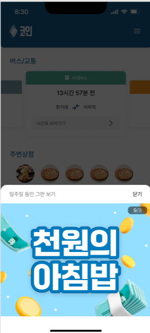
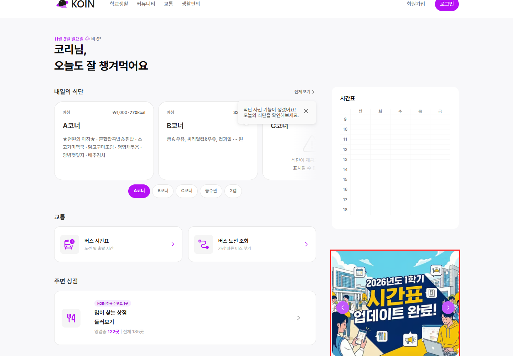

# 1-1. 메인_모달진입

[← 배너 로깅 목록](README.md)

플랫폼: ANDROID · IOS  
원문 상태: 로깅 필요

과거 로깅·새 로깅과 각 참고사진은 원문의 구간별 연결을 유지합니다.

<!-- logging-section:past:start -->
## 과거 로깅

- 설명: 메인화면 모달이 사용자에게 뜨는 순간 찍히는 로깅

- event\_name : “CAMPUS”

- event\_label : “main\_modal\_entry”

- value : \{title값\}

- event\_category : “entry” 

- 웹 참고사진

<!-- logging-section:past:end -->

<!-- logging-section:new:start -->
## 새 로깅

- 설명: 메인 화면의 배너 모달이 사용자에게 실제로 표시되는 순간 기록.
- screen\_view: main
- event\_name: <code>DA2</code>
- event\_label: <code>banner__main__modal__exposure</code>
- value: \{배너 ID\}
- event\_category: <code>exposure</code>

### 참고사진 (메인 모달 노출 · 기존 캡처 참조 사본)

웹

Stage 실제 화면 · 빨간 네모가 해당 클릭 대상

모바일

#### 모바일

<!-- logging-section:new:end -->

---

원문 정보

원본 ID: `5830221954bc837d86a8018acdb24641`  
[보존 원문](../../_archive/original/notion/pages/5830221954bc837d86a8018acdb24641.md)

