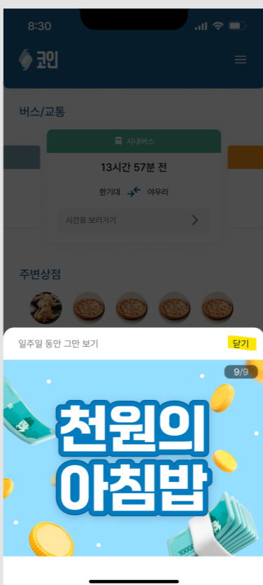
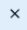

# 1-3. 메인_모달닫기_클릭

[← 배너 목록](README.md)

플랫폼: ANDROID, IOS  
원문 상태: 로깅 필요  
[Notion 기준 명세](https://app.notion.com/p/be30221954bc82bcb2258136d370dfc3)  
원본 ID: `be30221954bc82bcb2258136d370dfc3`

<!-- notion-body:start -->
## 과거 로깅

- 설명: 메인화면 모달의 닫기를 클릭
- event\_name : “CAMPUS”
- event\_label : “main\_modal\_close”
- value : \{title값\}
- event\_category : “click”
- 참고사진



- 웹 참고사진


## 새 로깅

- 설명: 메인 화면의 배너 모달에서 닫기 버튼을 클릭.
- screen\_view:  main
- event\_name: <code>DA2</code>
- event\_label: <code>banner__main__modal__close__click</code>
- value: \{배너 ID\}
- event\_category: <code>click</code>

<b>참고사진 · 웹</b>

<b>웹 - 없음</b>

<b>참고사진 · 모바일</b>

<b>모바일</b>




<!-- notion-body:end -->

<details>
<summary>Notion 원문 속성 전체</summary>

```json
{
  "platform": [
    "ANDROID",
    "IOS"
  ],
  "url": "https://app.notion.com/p/be30221954bc82bcb2258136d370dfc3",
  "상태": "로깅 필요",
  "이름": "1-3. 메인\\_모달닫기\\_클릭",
  "태그": [
    "1. 메인_모달"
  ]
}
```

</details>
