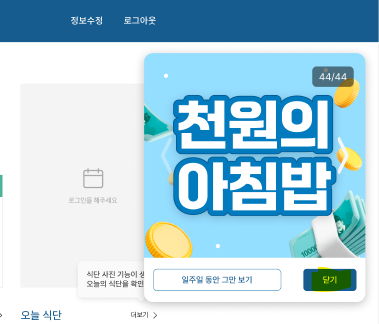

# 1-3. 메인_모달닫기_클릭

[← 배너 로깅 목록](README.md)

플랫폼: ANDROID · IOS  
원문 상태: 로깅 필요

과거 로깅·새 로깅과 각 참고사진은 원문의 구간별 연결을 유지합니다.

<!-- logging-section:past:start -->
## 과거 로깅

- 설명: 메인화면 모달의 닫기를 클릭
- event\_name : “CAMPUS”
- event\_label : “main\_modal\_close”
- value : \{title값\}
- event\_category : “click”
- 참고사진

- 웹 참고사진

<!-- logging-section:past:end -->

<!-- logging-section:new:start -->
## 새 로깅

- 설명: 메인 화면의 배너 모달에서 닫기 버튼을 클릭.
- screen\_view:  main
- event\_name: <code>DA2</code>
- event\_label: <code>banner__main__modal__close__click</code>
- value: \{배너 ID\}
- event\_category: <code>click</code>

<b>참고사진 · 웹</b>

<b>웹 - 없음</b>

<b>참고사진 · 모바일</b>

<b>모바일</b>

<!-- logging-section:new:end -->

---

원문 정보

원본 ID: `8b40221954bc82cd91bf01330ca8180a`  
[보존 원문](../../_archive/original/notion/pages/8b40221954bc82cd91bf01330ca8180a.md)

