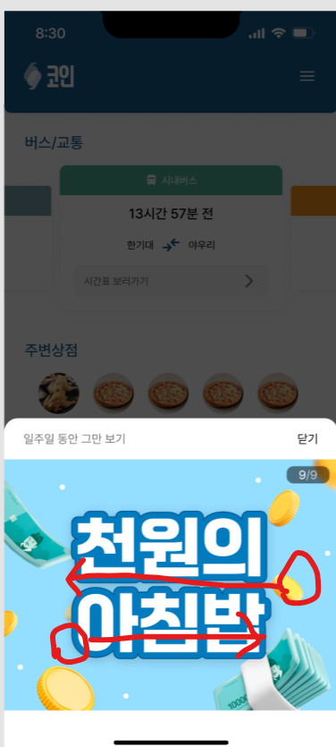
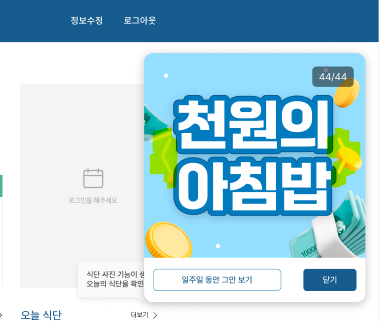
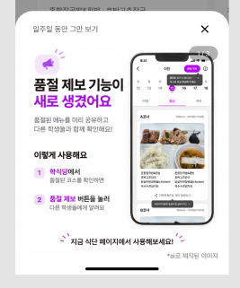

# 1-5. (모바일)메인_다음모달 - swipe

[← 배너 목록](README.md)

플랫폼: IOS  
원문 상태: 로깅 필요  
[Notion 기준 명세](https://app.notion.com/p/fc10221954bc83859fae0174bd9ba9bd)  
원본 ID: `fc10221954bc83859fae0174bd9ba9bd`

<!-- notion-body:start -->
### 플랫폼별 계약 범위

2026-11-27 사용자 확정: <b>swipe는 IOS 전용</b>이다. Android·Web의 기존 swipe 수집은 지원 범위 밖 전송으로 검수하며, 과거 기록을 개명하거나 click으로 자동 치환하지 않는다. 아래 표는 이 페이지의 개별 계약 범위이며 페이지 platform 속성은 확정된 범위의 합집합이다. 문서 수정은 SDK 배포·실수집 정상 완료를 뜻하지 않는다.

| event\_label | platform |
| --- | --- |
| <code>banner__main__modal__next__swipe</code> | IOS |

## 과거 로깅

- 설명: 메인화면 모달의 다음 모달로 스왑
- event\_name : “CAMPUS”
- event\_label : “main\_next\_modal”
- value : \{title값\} (넘긴 후의)
- event\_category : “swipe”
- 참고사진



- 웹 참고사진



## 새 로깅

- 설명: 메인 화면의 배너 모달을 스와이프하여 다음 배너로 넘김.
- screen\_view: main
- event\_name: <code>DA2</code>
- event\_label: <code>banner__main__modal__next__swipe</code>
- value: \{넘긴 후의 배너 ID\}
- event\_category: <code>swipe</code>

<b>참고사진 · 모바일</b>

<b>모바일</b>


<!-- notion-body:end -->

<details>
<summary>Notion 원문 속성 전체</summary>

```json
{
  "platform": [
    "IOS"
  ],
  "url": "https://app.notion.com/p/fc10221954bc83859fae0174bd9ba9bd",
  "상태": "로깅 필요",
  "이름": "1-5. (모바일)메인\\_다음모달 - swipe",
  "태그": [
    "1. 메인_모달"
  ]
}
```

</details>
