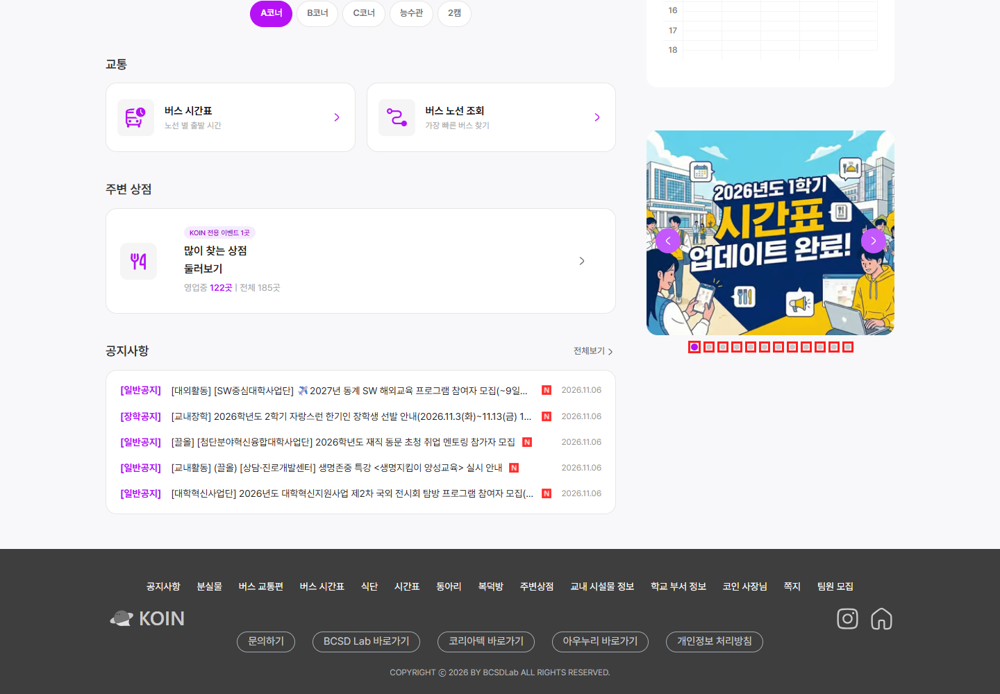

# 1-7. (웹) 메인_모달_밑에 버튼 클릭

[← 배너 로깅 목록](README.md)

플랫폼: WEB  
원문 상태: 로깅 필요

과거 로깅·새 로깅과 각 참고사진은 원문의 구간별 연결을 유지합니다.

> 참조 문서 · 대표 명세는 홈화면 리디자인 1-13
> 
> - 고정 배너 하단 점 선택의 현행 대표는 [1-13 고정 배너 하단 점 선택](../10-%ED%99%88%ED%99%94%EB%A9%B4-%EB%A6%AC%EB%94%94%EC%9E%90%EC%9D%B8/1-13-%EA%B3%A0%EC%A0%95-%EB%B0%B0%EB%84%88-%ED%95%98%EB%8B%A8-%EC%A0%90-%EC%84%A0%ED%83%9D.md)이다.
> - 이 페이지는 같은 계약의 참조·이력 보존 문서이며 별도 신규 이벤트나 추가 전송 대상이 아니다. 같은 클릭 한 번에 두 문서의 로그를 따로 전송하지 않는다.
> - 아래 과거·새 정의, 라벨·값·발생 조건·사진은 보존한다. 실제 SDK 반영·한 번 전송 검증은 별도다.

<!-- logging-section:past:start -->
## 과거 로깅

없음

<!-- logging-section:past:end -->

<!-- logging-section:new:start -->
## 새 로깅

- 설명: PC 메인 화면의 고정 배너 하단 페이지 점을 직접 클릭했을 때 한 번 기록한다. 이전·다음 화살표 클릭과 자동 전환은 포함하지 않는다.
- screen\_view: <code>main</code>
- event\_name: <code>DA2</code>
- event\_label: <code>banner__main__fixed_banner__page_select__click</code>
- value: \{클릭 직전 표시 중인 배너 제목\}
- event\_category: <code>click</code>

### 참고사진 · 웹

Stage 실제 화면 · 빨간 네모가 해당 클릭 대상

<!-- logging-section:new:end -->

---

원문 정보

원본 ID: `1130221954bc83bd92b6016800ed6fa8`  
[보존 원문](../../_archive/original/notion/pages/1130221954bc83bd92b6016800ed6fa8.md)

