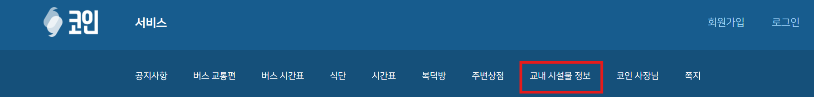

# 10-1. 헤더_교내 시설물 정보_클릭

[← 배너 목록](README.md)

플랫폼: WEB  
원문 상태: 완료  
[Notion 기준 명세](https://app.notion.com/p/d1f0221954bc8288a9b481707a8a54f5)  
원본 ID: `d1f0221954bc8288a9b481707a8a54f5`

<!-- notion-body:start -->
- 설명: 헤더 에서 교내 시설물 정보 클릭
- event\_label : “header”
- value : “교내 시설물 정보”
- event\_category : “click”
- 참고사진



## 검토사항

- 후속 수정 (2026-10-27): ※ 옛 사본: 현행 명세는 게시판 DB의 같은 번호 페이지 [10-1. 헤더_교내 시설물 정보_클릭](https://app.notion.com/p/caa0221954bc8368b74a81ba4866e31d). 이 사본은 새 로깅이 없어 label 변환 대상이 아니며 변환하지 않음.
<!-- notion-body:end -->

<details>
<summary>Notion 원문 속성 전체</summary>

```json
{
  "platform": [
    "WEB"
  ],
  "url": "https://app.notion.com/p/d1f0221954bc8288a9b481707a8a54f5",
  "상태": "완료",
  "이름": "10-1. 헤더\\_교내 시설물 정보\\_클릭"
}
```

</details>
