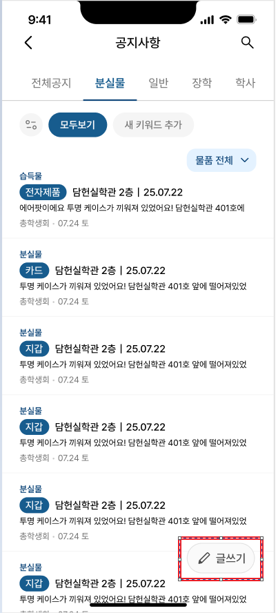
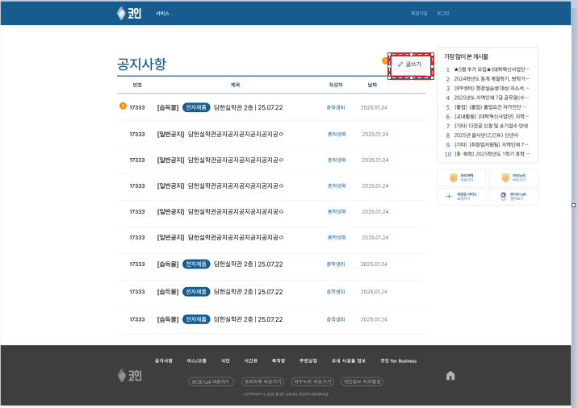
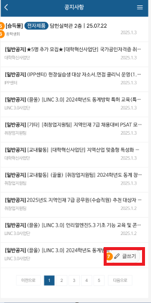

# 11-1.분실물_글쓰기_클릭

[← 배너 로깅 목록](README.md)

플랫폼: ANDROID · IOS · WEB  
원문 상태: 완료

원문에 과거·새 로깅 구분이 없어 아래 정의와 참고사진을 원문 순서로 표시합니다.

원문 미기재 항목: `event_name`, `screen_view`. 값을 추정하지 않았습니다.

- 설명: 분실물 페이지 에서 글쓰기 버튼 클릭(모바일)
- 웹: 공지사항 페이지에서 글쓰기 버튼 클릭
- event\_label : “item\_write”
- value : “글쓰기”
- event\_category : “click”

WEB Mobile View

---

원문 정보

원본 ID: `d860221954bc839197140166ccb6103b`  
[보존 원문](../../_archive/original/notion/pages/d860221954bc839197140166ccb6103b.md)

