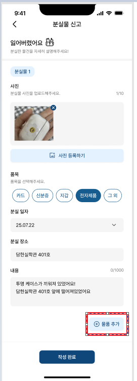

# 11-10.분실물_분실물신고_물품추가_클릭

[← 배너 로깅 목록](README.md)

플랫폼: ANDROID · IOS · WEB  
원문 상태: 완료

원문에 과거·새 로깅 구분이 없어 아래 정의와 참고사진을 원문 순서로 표시합니다.

원문 미기재 항목: `event_name`, `screen_view`. 값을 추정하지 않았습니다.

- 설명: 분실물 신고 글쓰기 페이지에서 물품 추가를 클릭
- event\_label : “lost\_item\_add\_item”
- value : “물품 추가”
- event\_category : “click”
- 참고사진

mobile\_view, mobile\_Web\_view

WEB : 예시 화면이 습득물 신고인데 분실물 신고랑 기능이 동일해서 넣었습니다.

---

원문 정보

원본 ID: `2a10221954bc82a5bd43813af587afdc`  
[보존 원문](../../_archive/original/notion/pages/2a10221954bc82a5bd43813af587afdc.md)

