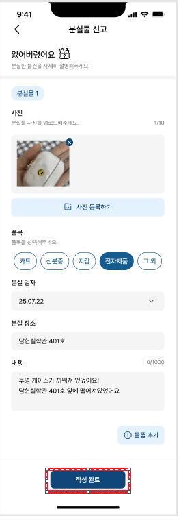

# 11-11.분실물_분실물신고_작성완료_클릭

[← 배너 목록](README.md)

플랫폼: ANDROID, IOS, WEB  
원문 상태: 완료  
[Notion 기준 명세](https://app.notion.com/p/c130221954bc823a841c010fe252d1ed)  
원본 ID: `c130221954bc823a841c010fe252d1ed`

<!-- notion-body:start -->
- 설명:  습득물 신고 글쓰기 페이지에서 작성완료 클릭
- event\_label : “lost\_item\_write\_confirm”
- value : “작성 완료”
- event\_category : “click”
- 참고사진

mobile\_view, mobile\_Web\_view



WEB : 예시 화면이 습득물 신고인데 분실물 신고랑 기능이 동일해서 넣었습니다.


<!-- notion-body:end -->

<details>
<summary>Notion 원문 속성 전체</summary>

```json
{
  "platform": [
    "ANDROID",
    "IOS",
    "WEB"
  ],
  "url": "https://app.notion.com/p/c130221954bc823a841c010fe252d1ed",
  "상태": "완료",
  "이름": "11-11.분실물\\_분실물신고\\_작성완료\\_클릭"
}
```

</details>
