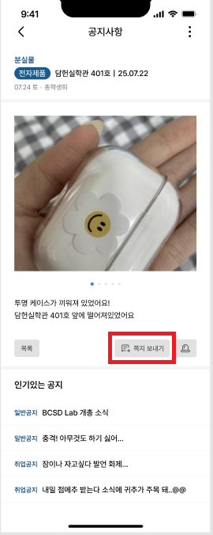
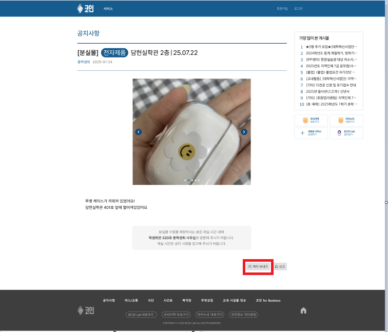
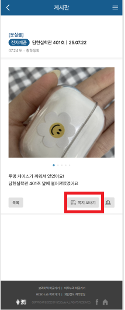

# 11-12.분실물_쪽지보내기_클릭

[← 배너 로깅 목록](README.md)

플랫폼: ANDROID · IOS · WEB  
원문 상태: 완료

원문에 과거·새 로깅 구분이 없어 아래 정의와 참고사진을 원문 순서로 표시합니다.

원문 미기재 항목: `event_name`, `screen_view`. 값을 추정하지 않았습니다.

- 설명:   게시글에서 쪽지 보내기 버튼 클릭, value 값은 게시글 종류에 따라서 "분실물 쪽지 보내기", "습득물 쪽지 보내기”로 구분
- event\_label : “item\_message\_send”
- value :  "분실물 쪽지 보내기", "습득물 쪽지 보내기”
- event\_category : “click”

mobile\_view, mobile\_Web\_view

WEB

Mobile\_Web\_View

---

원문 정보

원본 ID: `87f0221954bc83329ea20157407117c2`  
[보존 원문](../../_archive/original/notion/pages/87f0221954bc83329ea20157407117c2.md)

