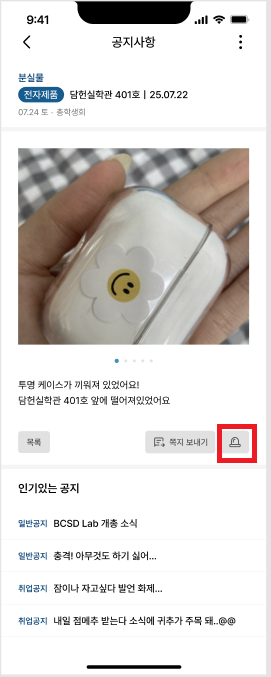
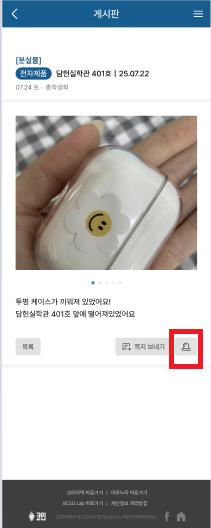

# 11-13.분실물_신고하기_클릭

[← 배너 목록](README.md)

플랫폼: ANDROID, IOS, WEB  
원문 상태: 완료  
[Notion 기준 명세](https://app.notion.com/p/a060221954bc839a9bae81832ce4c1dd)  
원본 ID: `a060221954bc839a9bae81832ce4c1dd`

<!-- notion-body:start -->
- 설명:  게시글에서 신고하기 버튼 클릭
- event\_label : “item\_post\_report”
- value : “신고하기”
- event\_category : “click”
- 참고사진

mobile\_view



WEB


mobile\_Web\_view


<!-- notion-body:end -->

<details>
<summary>Notion 원문 속성 전체</summary>

```json
{
  "platform": [
    "ANDROID",
    "IOS",
    "WEB"
  ],
  "url": "https://app.notion.com/p/a060221954bc839a9bae81832ce4c1dd",
  "상태": "완료",
  "이름": "11-13.분실물\\_신고하기\\_클릭"
}
```

</details>
