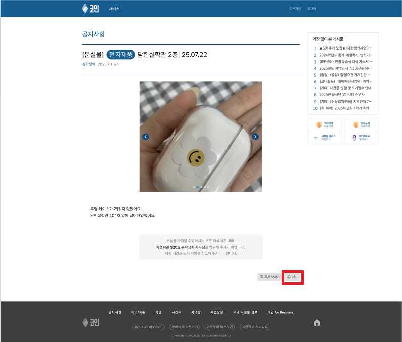

# 11-13.분실물_신고하기_클릭

[← 배너 로깅 목록](README.md)

플랫폼: ANDROID · IOS · WEB  
원문 상태: 완료

원문에 과거·새 로깅 구분이 없어 아래 정의와 참고사진을 원문 순서로 표시합니다.

원문 미기재 항목: `event_name`, `screen_view`. 값을 추정하지 않았습니다.

- 설명:  게시글에서 신고하기 버튼 클릭
- event\_label : “item\_post\_report”
- value : “신고하기”
- event\_category : “click”
- 참고사진

mobile\_view

WEB

mobile\_Web\_view

---

원문 정보

원본 ID: `a460221954bc828aad4e81e89cdd8a62`  
[보존 원문](../../_archive/original/notion/pages/a460221954bc828aad4e81e89cdd8a62.md)

