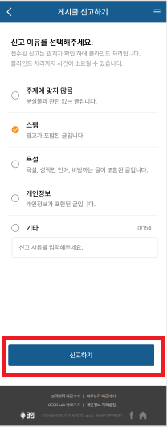

# 11-14.분실물_게시글신고하기_신고하기_클릭

[← 배너 목록](README.md)

플랫폼: ANDROID, IOS, WEB  
원문 상태: 완료  
[Notion 기준 명세](https://app.notion.com/p/2250221954bc822581ab81e7101fc627)  
원본 ID: `2250221954bc822581ab81e7101fc627`

<!-- notion-body:start -->
- 설명:  게시글 신고하기에서 신고하기 버튼 클릭
- event\_label : “item\_post\_report\_confirm”
- value : <s>\{”주제에 맞지 않음”, ”스팸”, ”욕설”, ”개인정보”, ”기타”\} 5가지 값중 선택된 값을 추가</s>

→ value : “신고하기”

- event\_category : “click”
- 참고사진


WEB


Mobile\_Web\_VIEW


<!-- notion-body:end -->

<details>
<summary>Notion 원문 속성 전체</summary>

```json
{
  "platform": [
    "ANDROID",
    "IOS",
    "WEB"
  ],
  "url": "https://app.notion.com/p/2250221954bc822581ab81e7101fc627",
  "상태": "완료",
  "이름": "11-14.분실물\\_게시글신고하기\\_신고하기\\_클릭"
}
```

</details>
