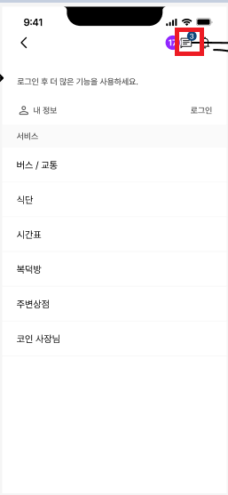

# 11-15.햄버거_쪽지_클릭

[← 배너 로깅 목록](README.md)

플랫폼: ANDROID · IOS · WEB  
원문 상태: 완료

원문에 과거·새 로깅 구분이 없어 아래 정의와 참고사진을 원문 순서로 표시합니다.

원문 미기재 항목: `event_name`, `screen_view`. 값을 추정하지 않았습니다.

- 설명 : 햄버거 버튼을 누른 화면에서 쪽지 버튼 클릭

- event\_label : “hamburger”

- value : “쪽지<b>”</b>

- event\_category : “click” 

- 참고사진

검토사항

- 후속 수정 (2026-10-27): ※ 옛 사본: 현행 명세는 게시판 DB의 같은 번호 페이지 [[레거시] 11-15.카테고리_채팅(쪽지)_클릭](0dc0221954bc8316be7a815e4460791f.md) (11-15.카테고리\_채팅(쪽지)\_클릭). 이 사본은 새 로깅이 없어 변환하지 않음.

---

원문 정보

원본 ID: `b6a0221954bc82a5b60a8120f0d08237`  
[보존 원문](../../_archive/original/notion/pages/b6a0221954bc82a5b60a8120f0d08237.md)

