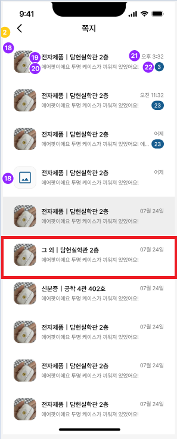
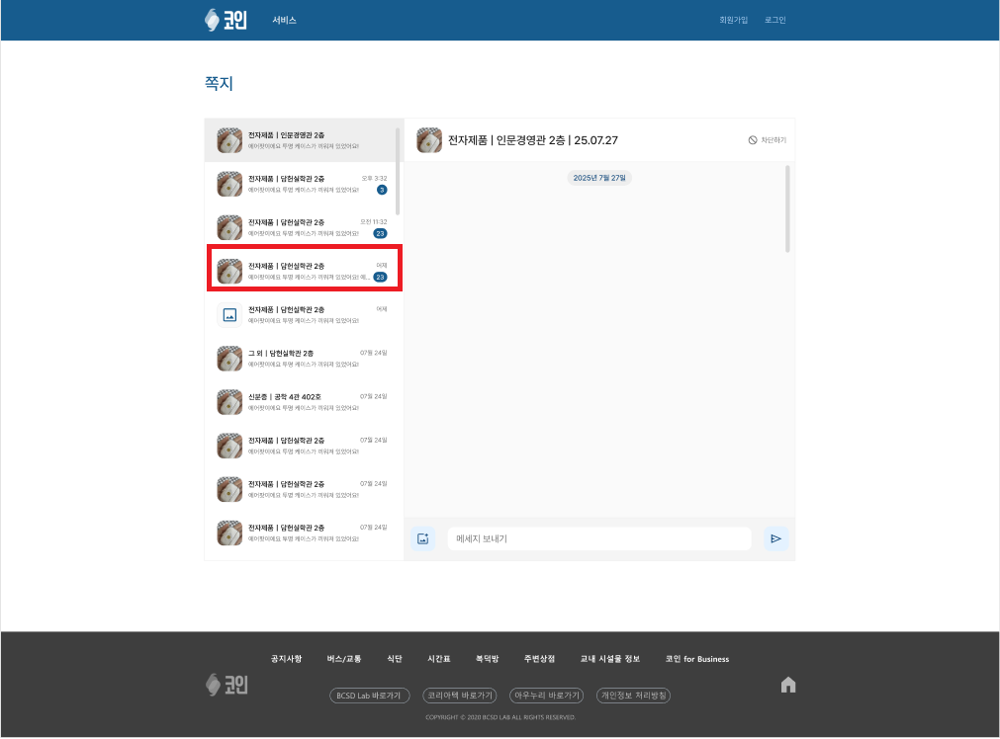

# 11-16.쪽지리스트_대화창_클릭

[← 배너 로깅 목록](README.md)

플랫폼: ANDROID · IOS · WEB  
원문 상태: 완료

원문에 과거·새 로깅 구분이 없어 아래 정의와 참고사진을 원문 순서로 표시합니다.

원문 미기재 항목: `event_name`, `screen_view`. 값을 추정하지 않았습니다.

- 설명:  쪽지 리스트에서 특정 대화창을 클릭
- event\_label : “message\_list\_select”
- value : “쪽지”
- event\_category : “click”
- 참고사진

Mobile, Mobile\_Web\_VIEW

WEB

검토사항

- 후속 수정 (2026-10-27): ※ 옛 사본: 현행 명세는 게시판 DB의 같은 번호 페이지 [11-16.쪽지리스트_대화창_클릭](../08-%EA%B2%8C%EC%8B%9C%ED%8C%90/11-16.%EC%AA%BD%EC%A7%80%EB%A6%AC%EC%8A%A4%ED%8A%B8_%EB%8C%80%ED%99%94%EC%B0%BD_%ED%81%B4%EB%A6%AD.md). 이 사본은 새 로깅이 없어 변환하지 않음.

---

원문 정보

원본 ID: `3d30221954bc8340af35815fad5295d0`  
[보존 원문](../../_archive/original/notion/pages/3d30221954bc8340af35815fad5295d0.md)

