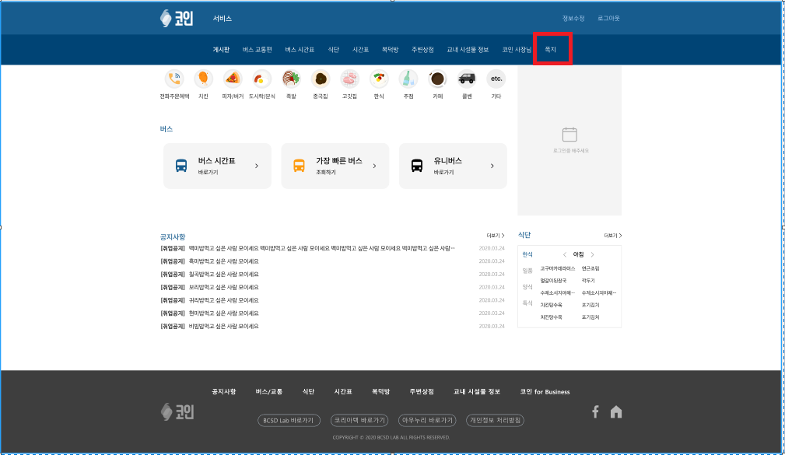

# 11-17.헤더_쪽지_클릭

[← 배너 목록](README.md)

플랫폼: WEB  
원문 상태: 완료  
[Notion 기준 명세](https://app.notion.com/p/3570221954bc8352995a01b782815e2d)  
원본 ID: `3570221954bc8352995a01b782815e2d`

<!-- notion-body:start -->
- 설명:  웹 페이지 헤더 에서 쪽지 버튼 클릭
- event\_label : “header”
- value : “쪽지”
- event\_category : “click”
- 참고사진

WEB



## 검토사항

- 후속 수정 (2026-10-27): ※ 옛 사본: 현행 명세는 게시판 DB의 같은 번호 페이지 [11-17.헤더_쪽지_클릭](https://app.notion.com/p/b5b0221954bc83c084f6813c7f8c3190). 이 사본은 새 로깅이 없어 변환하지 않음.
<!-- notion-body:end -->

<details>
<summary>Notion 원문 속성 전체</summary>

```json
{
  "platform": [
    "WEB"
  ],
  "url": "https://app.notion.com/p/3570221954bc8352995a01b782815e2d",
  "상태": "완료",
  "이름": "11-17.헤더\\_쪽지\\_클릭"
}
```

</details>
