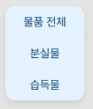
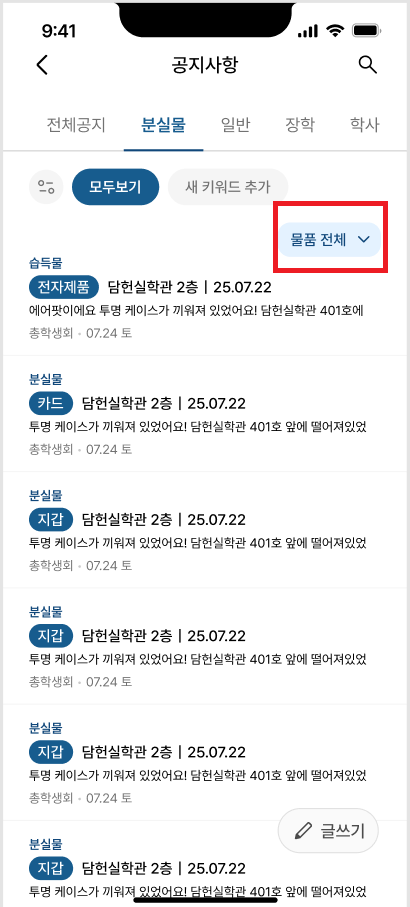

# 11-18.분실물_게시물종류_클릭

[← 배너 목록](README.md)

플랫폼: ANDROID, IOS  
원문 상태: 완료  
[Notion 기준 명세](https://app.notion.com/p/0290221954bc831c8de78111f8908eed)  
원본 ID: `0290221954bc831c8de78111f8908eed`

<!-- notion-body:start -->
- 설명 : 분실물 게시글 목록에서 첨부파일에 표시된 버튼을 클릭하여 3개의 버튼중 1개의 버튼을 클릭
- event\_label : “item\_post\_type”
- value : “물품 전체<b>”, “분실물”, “습득물”</b>
- event\_category : “click”
- 참고사진
- WEB, MOBILE\_WEB\_VIEW는 디자인 에서 해당 기능이 없었습니다.




<!-- notion-body:end -->

<details>
<summary>Notion 원문 속성 전체</summary>

```json
{
  "platform": [
    "ANDROID",
    "IOS"
  ],
  "url": "https://app.notion.com/p/0290221954bc831c8de78111f8908eed",
  "상태": "완료",
  "이름": "11-18.분실물\\_게시물종류\\_클릭"
}
```

</details>
