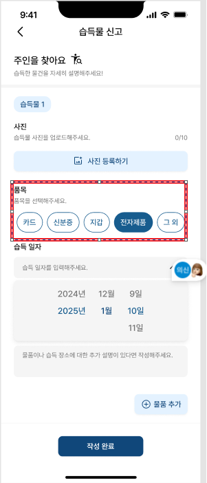
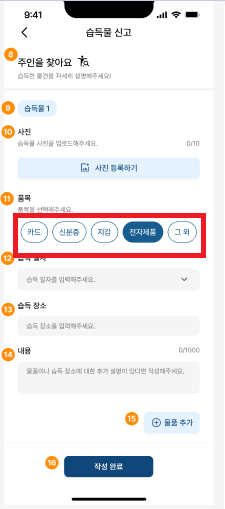

# 11-2.분실물_습득물신고_품목선택_클릭

[← 배너 목록](README.md)

플랫폼: ANDROID, IOS, WEB  
원문 상태: 완료  
[Notion 기준 명세](https://app.notion.com/p/efa0221954bc8234a54b0187db002627)  
원본 ID: `efa0221954bc8234a54b0187db002627`

<!-- notion-body:start -->
- 설명: 습득물 신고 글쓰기 페이지에서 ‘품목을 선택해주세요.’ 버튼을 클릭하여 품목을 선택
- event\_label : “find\_user\_category”
- value : \{”카드”, ”신분증”, ”지갑”, ”전자제품”, ”<s>그 외</s>”\} 5가지 값을 추가
- → “그 외”를 “기타”로 변경(2025-02-23)
- event\_category : “click”
- 참고사진




WEB Mobile View


<!-- notion-body:end -->

<details>
<summary>Notion 원문 속성 전체</summary>

```json
{
  "platform": [
    "ANDROID",
    "IOS",
    "WEB"
  ],
  "url": "https://app.notion.com/p/efa0221954bc8234a54b0187db002627",
  "상태": "완료",
  "이름": "11-2.분실물\\_습득물신고\\_품목선택\\_클릭"
}
```

</details>
