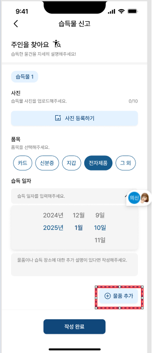
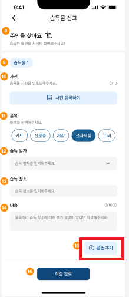

# 11-3.분실물_습득물신고_물품추가_클릭

[← 배너 목록](README.md)

플랫폼: ANDROID, IOS, WEB  
원문 상태: 완료  
[Notion 기준 명세](https://app.notion.com/p/99d0221954bc835898c701ab30e1fd14)  
원본 ID: `99d0221954bc835898c701ab30e1fd14`

<!-- notion-body:start -->
- 설명:   습득물 신고 글쓰기 페이지에서 물품 추가 클릭
- event\_label : “find\_user\_add\_item”
- value : “물품 추가”
- event\_category : “click”
- 참고사진




WEB Mobile View


<!-- notion-body:end -->

<details>
<summary>Notion 원문 속성 전체</summary>

```json
{
  "platform": [
    "ANDROID",
    "IOS",
    "WEB"
  ],
  "url": "https://app.notion.com/p/99d0221954bc835898c701ab30e1fd14",
  "상태": "완료",
  "이름": "11-3.분실물\\_습득물신고\\_물품추가\\_클릭"
}
```

</details>
