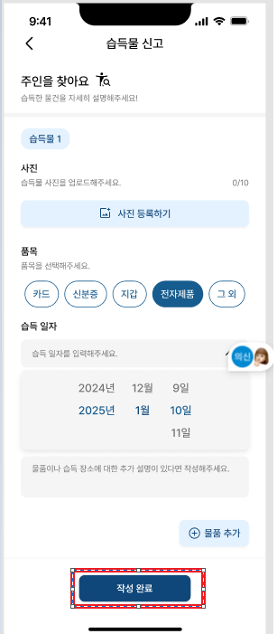
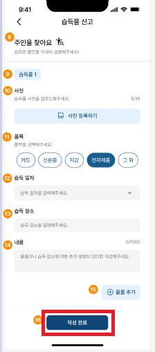

# 11-4.분실물_습득물신고_작성완료_클릭

[← 배너 목록](README.md)

플랫폼: ANDROID, IOS, WEB  
원문 상태: 완료  
[Notion 기준 명세](https://app.notion.com/p/1b20221954bc82299ddd81e3564b9e88)  
원본 ID: `1b20221954bc82299ddd81e3564b9e88`

<!-- notion-body:start -->
- 설명:  습득물 신고 글쓰기 페이지에서 작성완료 클릭
- event\_label : “find\_user\_write\_confirm”
- value : “작성완료”
- event\_category : “click”
- 참고사진




WEB Mobile View


<!-- notion-body:end -->

<details>
<summary>Notion 원문 속성 전체</summary>

```json
{
  "platform": [
    "ANDROID",
    "IOS",
    "WEB"
  ],
  "url": "https://app.notion.com/p/1b20221954bc82299ddd81e3564b9e88",
  "상태": "완료",
  "이름": "11-4.분실물\\_습득물신고\\_작성완료\\_클릭"
}
```

</details>
