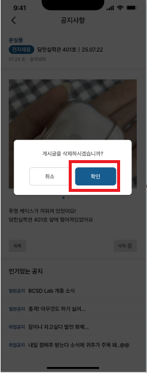
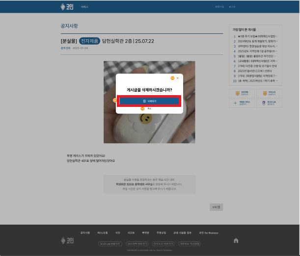
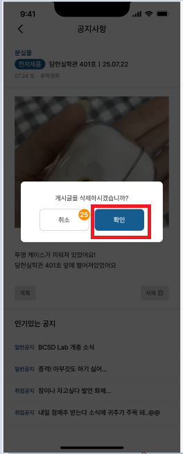

# 11-6.분실물_습득물신고_삭제확인_클릭

[← 배너 목록](README.md)

플랫폼: ANDROID, IOS, WEB  
원문 상태: 완료  
[Notion 기준 명세](https://app.notion.com/p/2520221954bc835c8b4d01474b9a4c99)  
원본 ID: `2520221954bc835c8b4d01474b9a4c99`

<!-- notion-body:start -->
- 설명:  글 작성자가 습득물 신고 게시물을 삭제버튼을 클릭하고, 나타나는 창에서 확인 버튼을 클릭
- event\_label : “find\_user\_delete\_confirm”
- value : “확인”
- event\_category : “click”
- 참고사진





WEB Mobile View


<!-- notion-body:end -->

<details>
<summary>Notion 원문 속성 전체</summary>

```json
{
  "platform": [
    "ANDROID",
    "IOS",
    "WEB"
  ],
  "url": "https://app.notion.com/p/2520221954bc835c8b4d01474b9a4c99",
  "상태": "완료",
  "이름": "11-6.분실물\\_습득물신고\\_삭제확인\\_클릭"
}
```

</details>
