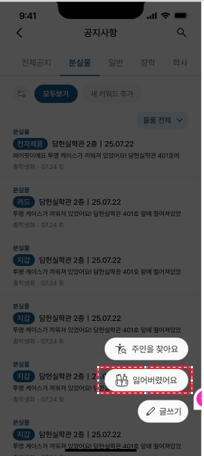
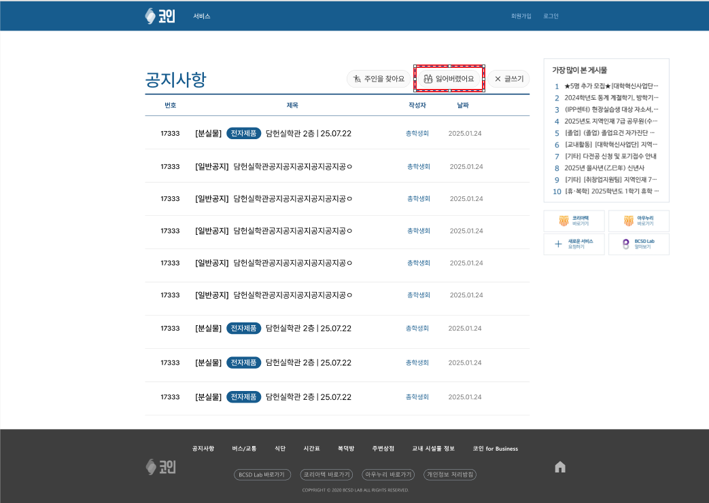

# 11-7.분실물_잃어버렸어요_클릭

[← 배너 목록](README.md)

플랫폼: ANDROID, IOS, WEB  
원문 상태: 완료  
[Notion 기준 명세](https://app.notion.com/p/8e10221954bc82d2a2d70167c20cdfd3)  
원본 ID: `8e10221954bc82d2a2d70167c20cdfd3`

<!-- notion-body:start -->
- 설명: 분실물 페이지 에서 글쓰기 버튼 클릭 후 나타나는  잃어버렸어요 버튼 클릭
- event\_label : “lost\_item\_write”
- value : “잃어버렸어요”
- event\_category : “click”
- 참고사진



WEB



Mobile\_WEB\_VIEW


<!-- notion-body:end -->

<details>
<summary>Notion 원문 속성 전체</summary>

```json
{
  "platform": [
    "ANDROID",
    "IOS",
    "WEB"
  ],
  "url": "https://app.notion.com/p/8e10221954bc82d2a2d70167c20cdfd3",
  "상태": "완료",
  "이름": "11-7.분실물\\_잃어버렸어요\\_클릭"
}
```

</details>
