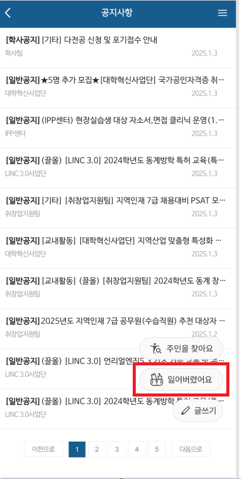

# 11-7.분실물_잃어버렸어요_클릭

[← 배너 로깅 목록](README.md)

플랫폼: ANDROID · IOS · WEB  
원문 상태: 완료

원문에 과거·새 로깅 구분이 없어 아래 정의와 참고사진을 원문 순서로 표시합니다.

원문 미기재 항목: `event_name`, `screen_view`. 값을 추정하지 않았습니다.

- 설명: 분실물 페이지 에서 글쓰기 버튼 클릭 후 나타나는  잃어버렸어요 버튼 클릭
- event\_label : “lost\_item\_write”
- value : “잃어버렸어요”
- event\_category : “click”

WEB

Mobile\_WEB\_VIEW

---

원문 정보

원본 ID: `f810221954bc83d0809e01628492c45e`  
[보존 원문](../../_archive/original/notion/pages/f810221954bc83d0809e01628492c45e.md)

