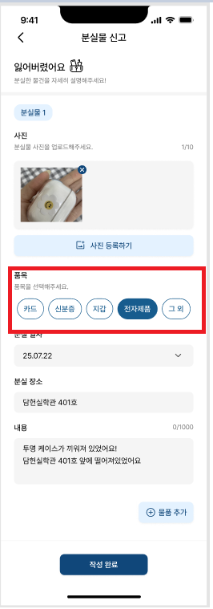

# 11-9.분실물_분실물신고_품목선택_클릭

[← 배너 목록](README.md)

플랫폼: ANDROID, IOS, WEB  
원문 상태: 완료  
[Notion 기준 명세](https://app.notion.com/p/0e50221954bc82c6879d015cb673d361)  
원본 ID: `0e50221954bc82c6879d015cb673d361`

<!-- notion-body:start -->
- 설명: 분실물 신고 글쓰기 페이지에서 특정 품목을 클릭
- event\_label : “lost\_item\_category”
- value :  \{”카드”, ”신분증”, ”지갑”, ”전자제품”, ”<s>그 외</s>”\} 5가지 값을 추가
- → “그 외”를 “기타”로 변경(2025-02-23)
- event\_category : “click”
- 참고사진

mobile\_view, mobile\_Web\_view



WEB : 예시 화면이 습득물 신고인데 분실물 신고랑 기능이 동일해서 넣었습니다.


<!-- notion-body:end -->

<details>
<summary>Notion 원문 속성 전체</summary>

```json
{
  "platform": [
    "ANDROID",
    "IOS",
    "WEB"
  ],
  "url": "https://app.notion.com/p/0e50221954bc82c6879d015cb673d361",
  "상태": "완료",
  "이름": "11-9.분실물\\_분실물신고\\_품목선택\\_클릭"
}
```

</details>
