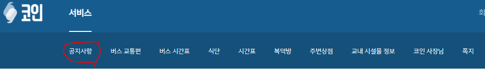

# 2-1. 헤더_공지사항_클릭

[← 배너 로깅 목록](README.md)

플랫폼: WEB  
원문 상태: 완료

원문에 과거·새 로깅 구분이 없어 아래 정의와 참고사진을 원문 순서로 표시합니다.

원문 미기재 항목: `event_name`, `screen_view`. 값을 추정하지 않았습니다.

- 설명: 헤더 에서 공지사항 클릭
- event\_label : “header”
- value : “공지사항”
- event\_category : “click”
- 참고사진

---

원문 정보

원본 ID: `b9f0221954bc82f1a11c8114101c6b39`  
[보존 원문](../../_archive/original/notion/pages/b9f0221954bc82f1a11c8114101c6b39.md)

