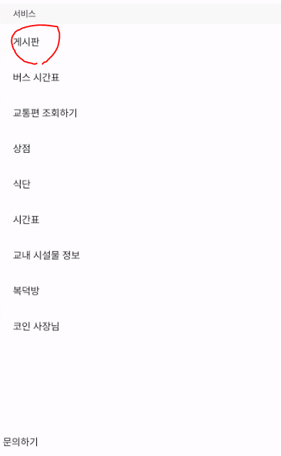

# 2-3. 햄버거_공지사항_클릭

[← 배너 목록](README.md)

플랫폼: ANDROID, IOS  
원문 상태: 완료  
[Notion 기준 명세](https://app.notion.com/p/2200221954bc83c89b89815432f6119b)  
원본 ID: `2200221954bc83c89b89815432f6119b`

<!-- notion-body:start -->
- 설명: 햄버거 에서 공지사항(게시판) 클릭
- event\_label : “hamburger”
- value : “공지사항”
- event\_category : “click”
- 참고사진


<!-- notion-body:end -->

<details>
<summary>Notion 원문 속성 전체</summary>

```json
{
  "platform": [
    "ANDROID",
    "IOS"
  ],
  "url": "https://app.notion.com/p/2200221954bc83c89b89815432f6119b",
  "상태": "완료",
  "이름": "2-3. 햄버거\\_공지사항\\_클릭"
}
```

</details>
