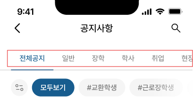

# 4-1. 탭 메뉴바_클릭

[← 배너 목록](README.md)

플랫폼: ANDROID, IOS  
원문 상태: 완료  
[Notion 기준 명세](https://app.notion.com/p/4dc0221954bc824e976d81c248630c1b)  
원본 ID: `4dc0221954bc824e976d81c248630c1b`

<!-- notion-body:start -->

각 탭 명을 value값으로 추가
<!-- notion-body:end -->

<details>
<summary>Notion 원문 속성 전체</summary>

```json
{
  "platform": [
    "ANDROID",
    "IOS"
  ],
  "url": "https://app.notion.com/p/4dc0221954bc824e976d81c248630c1b",
  "상태": "완료",
  "이름": "4-1. 탭 메뉴바\\_클릭"
}
```

</details>
