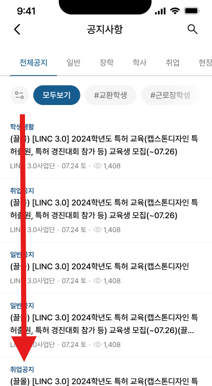

# 4-2. 공지사항 페이지_스크롤(상하)

[← 배너 목록](README.md)

플랫폼: ANDROID, IOS  
원문 상태: 완료  
[Notion 기준 명세](https://app.notion.com/p/62b0221954bc8330852b81b146b9d359)  
원본 ID: `62b0221954bc8330852b81b146b9d359`

<!-- notion-body:start -->

<!-- notion-body:end -->

<details>
<summary>Notion 원문 속성 전체</summary>

```json
{
  "platform": [
    "ANDROID",
    "IOS"
  ],
  "url": "https://app.notion.com/p/62b0221954bc8330852b81b146b9d359",
  "상태": "완료",
  "이름": "4-2. 공지사항 페이지\\_스크롤(상하)"
}
```

</details>
