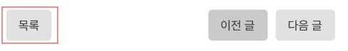

# 5-1. 목록_클릭

[← 배너 목록](README.md)

플랫폼: ANDROID, IOS  
원문 상태: 완료  
[Notion 기준 명세](https://app.notion.com/p/6430221954bc82e6bfba019111981d33)  
원본 ID: `6430221954bc82e6bfba019111981d33`

<!-- notion-body:start -->

<!-- notion-body:end -->

<details>
<summary>Notion 원문 속성 전체</summary>

```json
{
  "platform": [
    "ANDROID",
    "IOS"
  ],
  "url": "https://app.notion.com/p/6430221954bc82e6bfba019111981d33",
  "상태": "완료",
  "이름": "5-1. 목록\\_클릭"
}
```

</details>
