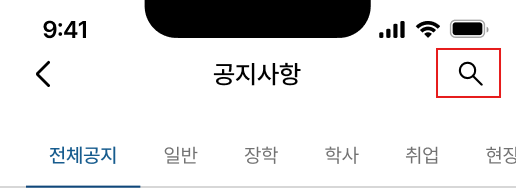

# 6-1. 공지글 검색_클릭

[← 배너 목록](README.md)

플랫폼: ANDROID, IOS  
원문 상태: 완료  
[Notion 기준 명세](https://app.notion.com/p/8a10221954bc82cdbf4b8121104dd140)  
원본 ID: `8a10221954bc82cdbf4b8121104dd140`

<!-- notion-body:start -->

<!-- notion-body:end -->

<details>
<summary>Notion 원문 속성 전체</summary>

```json
{
  "platform": [
    "ANDROID",
    "IOS"
  ],
  "url": "https://app.notion.com/p/8a10221954bc82cdbf4b8121104dd140",
  "상태": "완료",
  "이름": "6-1. 공지글 검색\\_클릭"
}
```

</details>
