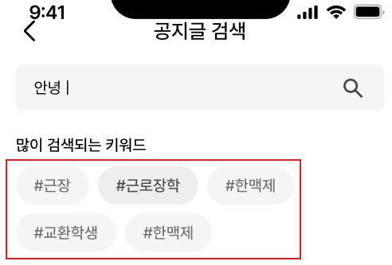

# 6-2. 많이 검색되는 키워드_클릭

[← 배너 목록](README.md)

플랫폼: ANDROID, IOS  
원문 상태: 완료  
[Notion 기준 명세](https://app.notion.com/p/3f00221954bc8358a4bf811e84430f42)  
원본 ID: `3f00221954bc8358a4bf811e84430f42`

<!-- notion-body:start -->

키워드를 value값으로 추가
<!-- notion-body:end -->

<details>
<summary>Notion 원문 속성 전체</summary>

```json
{
  "platform": [
    "ANDROID",
    "IOS"
  ],
  "url": "https://app.notion.com/p/3f00221954bc8358a4bf811e84430f42",
  "상태": "완료",
  "이름": "6-2. 많이 검색되는 키워드\\_클릭"
}
```

</details>
