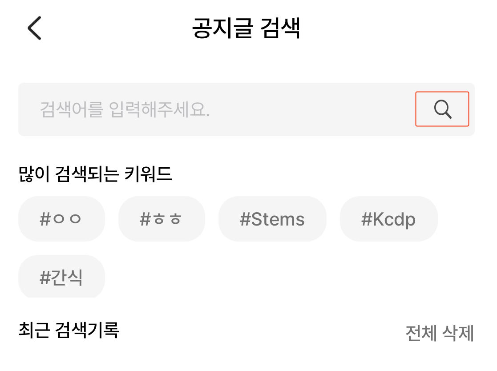

# 6-4. 공지글 검색_검색하기_클릭

[← 배너 목록](README.md)

플랫폼: ANDROID, IOS  
원문 상태: 완료  
[Notion 기준 명세](https://app.notion.com/p/3ea0221954bc8296a69b01e6956eff2f)  
원본 ID: `3ea0221954bc8296a69b01e6956eff2f`

<!-- notion-body:start -->
- 설명 : 공지글 검색 페이지에서 <u>최종 검색 버튼 클릭</u>
- 주의사항 : Enter, 돋보기 버튼 모두 로깅
- event\_label : “notice\_search\_event”
- value : “검색하기<b>”</b>
- event\_category : “click”
- 참고사진

  


<!-- notion-body:end -->

<details>
<summary>Notion 원문 속성 전체</summary>

```json
{
  "platform": [
    "ANDROID",
    "IOS"
  ],
  "url": "https://app.notion.com/p/3ea0221954bc8296a69b01e6956eff2f",
  "상태": "완료",
  "이름": "6-4. 공지글 검색\\_검색하기\\_클릭"
}
```

</details>
