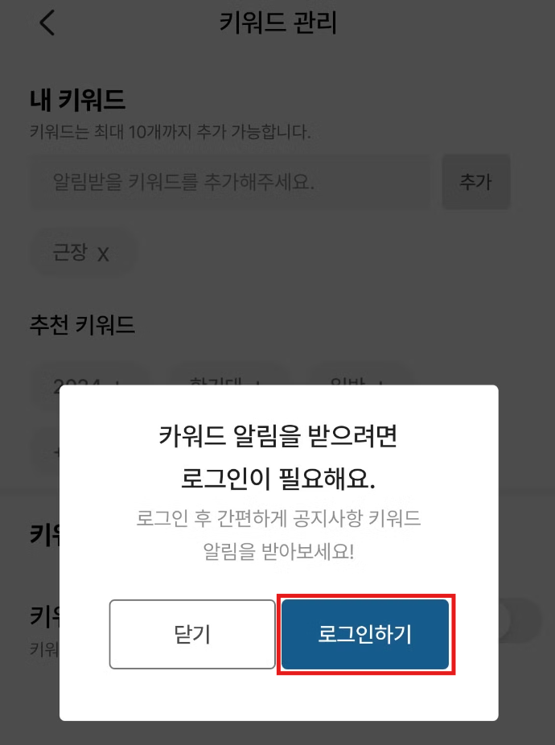

# 7-6. 로그인팝업_로그인하기_클릭

[← 배너 로깅 목록](README.md)

플랫폼: ANDROID · IOS  
원문 상태: 완료

원문에 과거·새 로깅 구분이 없어 아래 정의와 참고사진을 원문 순서로 표시합니다.

원문 미기재 항목: `event_name`, `event_label`, `screen_view`, `value`, `event_category`. 값을 추정하지 않았습니다.

---

원문 정보

원본 ID: `5e90221954bc83e58d6081e9c4b7bddd`  
[보존 원문](../../_archive/original/notion/pages/5e90221954bc83e58d6081e9c4b7bddd.md)

