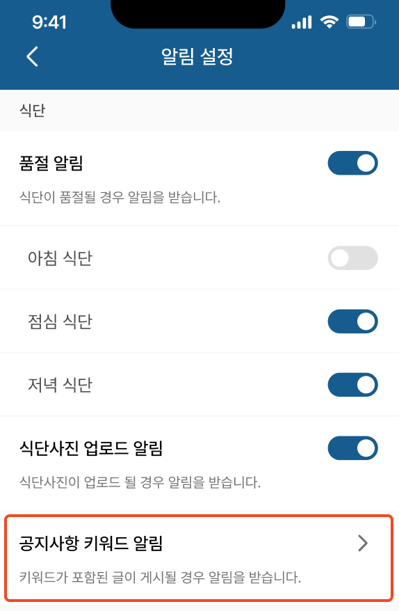

# 7-9. 알림설정_공지사항 키워드 알림_클릭

[← 배너 목록](README.md)

플랫폼: ANDROID, IOS  
원문 상태: 완료  
[Notion 기준 명세](https://app.notion.com/p/c430221954bc827fad278114a43b8df1)  
원본 ID: `c430221954bc827fad278114a43b8df1`

<!-- notion-body:start -->
- 설명 : <u>공지사항/키워드</u> 관리 페이지로 이동
- 주의사항 : 클릭 가능한 모든 요소(텍스트, 화살표) 로깅
- event\_label : “notification\_manage\_keyword”
- value : “공지사항 키워드 알림<b>”</b>
- event\_category : “click”
- 참고사진

  


<!-- notion-body:end -->

<details>
<summary>Notion 원문 속성 전체</summary>

```json
{
  "platform": [
    "ANDROID",
    "IOS"
  ],
  "url": "https://app.notion.com/p/c430221954bc827fad278114a43b8df1",
  "상태": "완료",
  "이름": "7-9. 알림설정\\_공지사항 키워드 알림\\_클릭"
}
```

</details>
