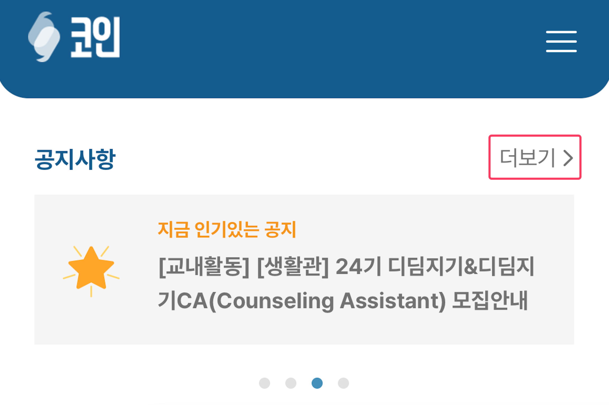

# 8-1. 더보기_클릭

[← 배너 목록](README.md)

플랫폼: ANDROID, IOS  
원문 상태: 완료  
[Notion 기준 명세](https://app.notion.com/p/0490221954bc82b29d6801f91e78f870)  
원본 ID: `0490221954bc82b29d6801f91e78f870`

<!-- notion-body:start -->
- event\_label : “app\_main\_notice\_detail”
- value : “더보기<b>”</b>
- event\_category : “click”
- 참고사진

  


<!-- notion-body:end -->

<details>
<summary>Notion 원문 속성 전체</summary>

```json
{
  "platform": [
    "ANDROID",
    "IOS"
  ],
  "url": "https://app.notion.com/p/0490221954bc82b29d6801f91e78f870",
  "상태": "완료",
  "이름": "8-1. 더보기\\_클릭"
}
```

</details>
