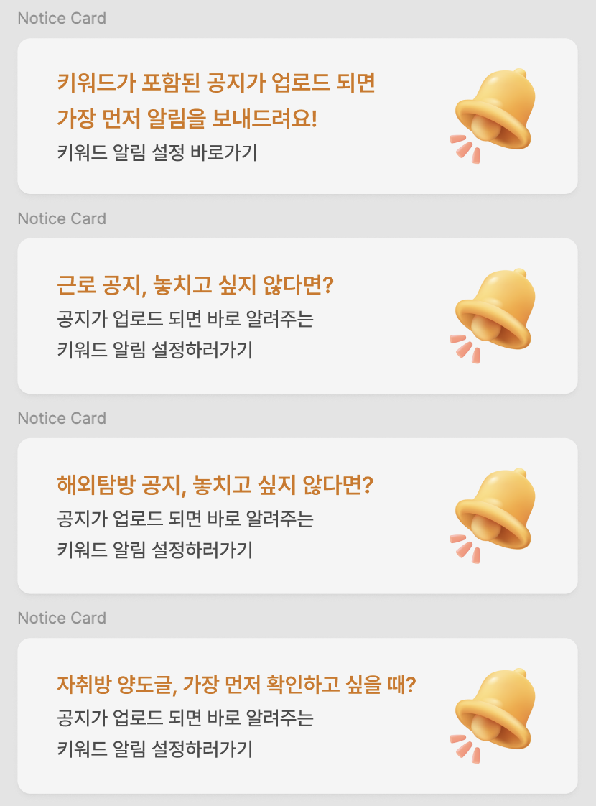

# 8-3. 키워드 관리 진입 배너_클릭

[← 배너 목록](README.md)

플랫폼: ANDROID, IOS  
원문 상태: 완료  
[Notion 기준 명세](https://app.notion.com/p/6dd0221954bc82a8847501645ef8ec98)  
원본 ID: `6dd0221954bc82a8847501645ef8ec98`

<!-- notion-body:start -->
- 설명 : 메인 배너에서 키워드 알림설정 바로가기 (A/B테스트용)

  - 첫 배너에서 사용자당 업데이트 후 7일마다 변경됨
- event\_label : “to\_manage\_keyword”
- value : “안내글”<b>, “근로”, “해외탐방”, “자취방 양도”</b>
- event\_category : “click”
- 참고사진

  


<!-- notion-body:end -->

<details>
<summary>Notion 원문 속성 전체</summary>

```json
{
  "platform": [
    "ANDROID",
    "IOS"
  ],
  "url": "https://app.notion.com/p/6dd0221954bc82a8847501645ef8ec98",
  "상태": "완료",
  "이름": "8-3. 키워드 관리 진입 배너\\_클릭"
}
```

</details>
