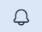
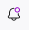

# 1-1 알림 클릭

[← 홈화면 리디자인 로깅 목록](README.md)

플랫폼: ANDROID · IOS  
원문 상태: 완료

과거 로깅·새 로깅과 각 참고사진은 원문의 구간별 연결을 유지합니다.

<!-- logging-section:past:start -->
## 과거 로깅

- event\_label : notification
- value : 알림 아이콘
- event\_category : click

<!-- logging-section:past:end -->

<!-- logging-section:new:start -->
## 새 로깅

<b>알림 아이콘</b>

- 설명: 메인 화면의 알림 아이콘을 눌러 공용 알림 목록으로 들어갈 때 클릭 1회를 기록한다.
- screen\_view: <code>main</code>
- event\_name: <code>DA2</code>
- event\_label: <code>main__main__notification_list__entry__click</code>
- value: 알림 아이콘
- event\_category: <code>click</code>

<!-- logging-section:new:end -->

---

원문 정보

원본 ID: `fee0221954bc83a49f7c0170fceecf9e`  
[보존 원문](../../_archive/original/notion/pages/fee0221954bc83a49f7c0170fceecf9e.md)

