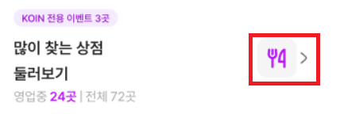
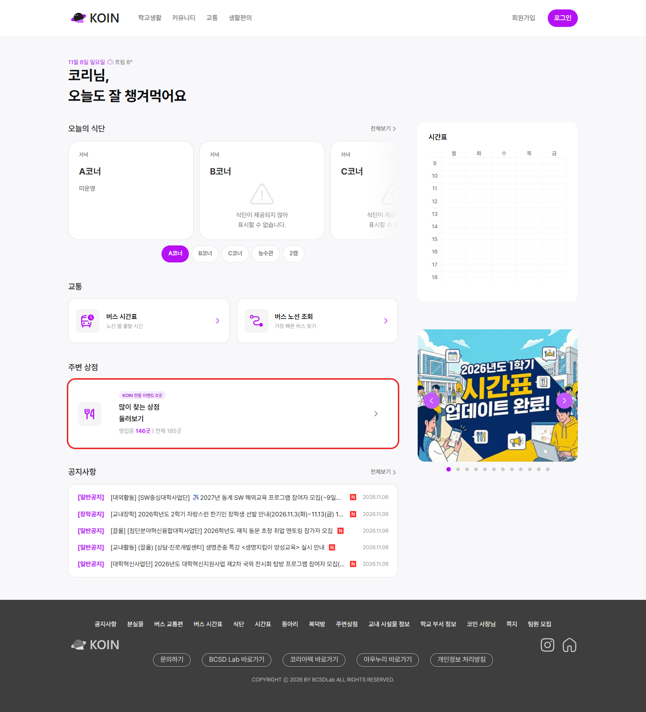

# 1-10 많이 찾는 상점 둘러보기 클릭

[← 홈화면 리디자인 로깅 목록](README.md)

플랫폼: ANDROID · IOS · WEB  
원문 상태: 완료

과거 로깅·새 로깅과 각 참고사진은 원문의 구간별 연결을 유지합니다.

<!-- logging-section:past:start -->
## 과거 로깅

- event\_label : popular\_shop
- value : 많이 찾는 상점 둘러보기
- event\_category : click

<!-- logging-section:past:end -->

<!-- logging-section:new:start -->
## 새 로깅

<b>많이 찾는 상점 둘러보기</b>

- 설명: 메인 화면의 많이 찾는 상점 둘러보기 버튼을 클릭할 때 기록한다. 주변상점 제목·전체보기 및 개별 카테고리 카드 클릭과 구분한다.
- screen\_view: <code>main</code>
- event\_name: <code>DA1</code>
- event\_label: <code>shop__main__shop_entry__popular_entry__click</code>
- value: 많이 찾는 상점 둘러보기
- event\_category: <code>click</code>

### 참고사진 (많이 찾는 상점 둘러보기 클릭)

<b>웹</b>

<b>참고사진 · 웹 (Stage 실제 화면)</b>

2026-11-08 [Stage 실제 서비스](https://stage.koreatech.in/) · PC 1440px 브라우저에서 직접 촬영했다. 빨간 테두리는 해당 명세의 버튼 위치다. 현재 WEB 위치 확인에는 이 실제 화면을 우선한다. 모바일 사진·기존 로깅 필드·DB 플랫폼 속성은 유지한다. 화면 확인은 SDK 전송·GA4 수집 검수 완료를 뜻하지 않는다.

<b>모바일</b>

<b>참고사진 · 모바일</b>

이번 WEB 이미지 작업에서 별도 확인하지 않음. 기존 원문 사진과 모바일 명세는 그대로 보존한다.

<!-- logging-section:new:end -->

---

원문 정보

원본 ID: `30a0221954bc8297844901591055351f`  
[보존 원문](../../_archive/original/notion/pages/30a0221954bc8297844901591055351f.md)

