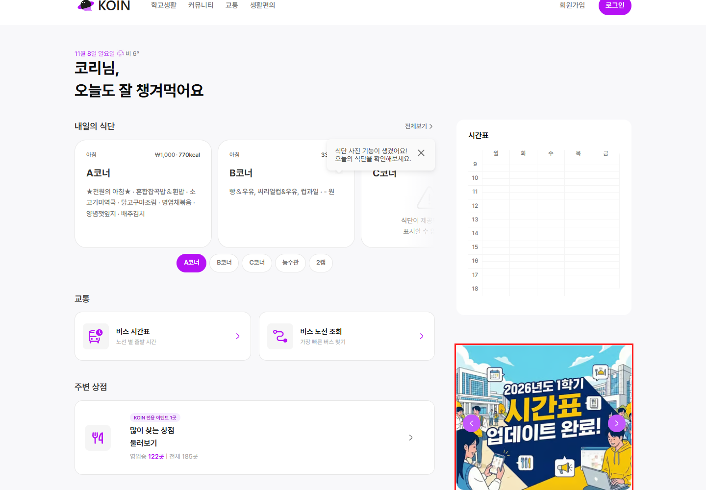

# 1-11 PC 홈 고정 배너 이미지 클릭

[← 홈화면 리디자인 목록](README.md)

플랫폼: WEB  
원문 상태: 로깅 필요  
[Notion 기준 명세](https://app.notion.com/p/4250221954bc81519f9ce0161b7528ea)  
원본 ID: `4250221954bc81519f9ce0161b7528ea`

<!-- notion-body:start -->
## 과거 로깅

- event\_name: <code>CAMPUS</code>
- event\_label: <code>main_modal</code>
- value: \{배너 제목\}
- event\_category: <code>click</code>

## 새 로깅 (26.11.28)

- 설명: PC 홈의 고정 배너 이미지 본문을 직접 클릭해 연결된 콘텐츠나 페이지로 이동을 시도할 때 1회 기록한다. 이전·다음 화살표, 하단 페이지 점, 자동 전환은 포함하지 않는다.
- 적용 플랫폼: WEB (PC 전용)
- screen\_view: <code>main</code>
- event\_name: <code>DA1</code>
- event\_label: <code>banner__main__fixed_banner__click</code>
- value: \{클릭 시 표시 중인 배너 제목\}
- event\_category: <code>click</code>

### 참고사진 · WEB (PC)


기존 Stage 실제 캡처 · 빨간 네모의 이미지 본문이 클릭 대상. 겹쳐 보이는 원형 화살표와 하단 점은 별도 계약이며 제외한다.
<!-- notion-body:end -->

<details>
<summary>Notion 원문 속성 전체</summary>

```json
{
  "platform": [
    "WEB"
  ],
  "url": "https://app.notion.com/p/4250221954bc81519f9ce0161b7528ea",
  "구분": "홈화면",
  "상태": "로깅 필요",
  "생성일": "2026-11-27T16:16:20.682Z",
  "이벤트 이름": "1-11 PC 홈 고정 배너 이미지 클릭"
}
```

</details>
