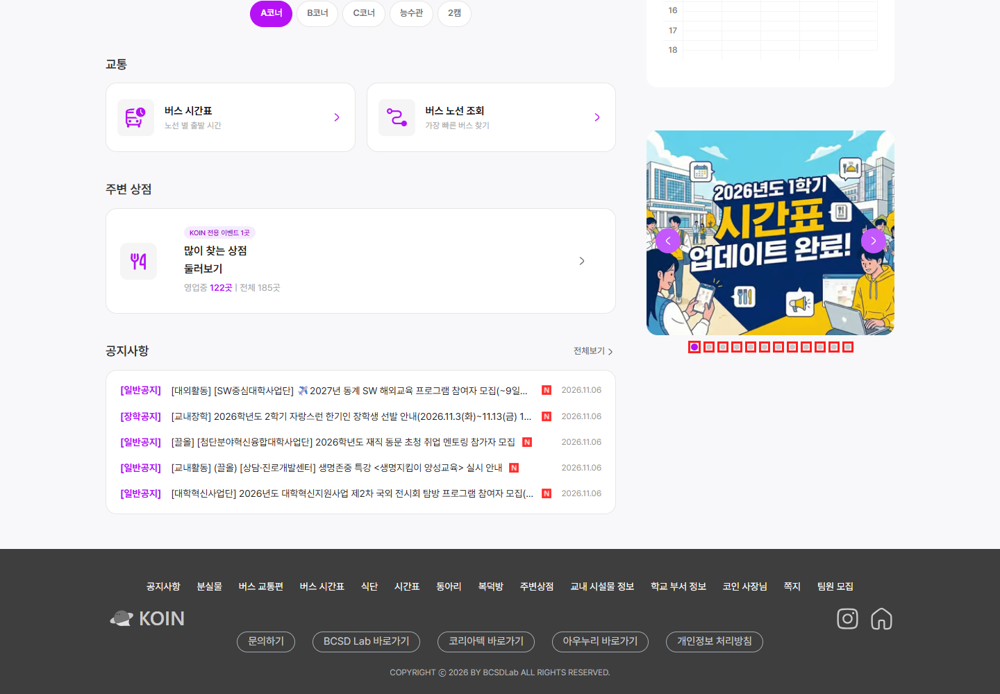

# 1-13 고정 배너 하단 점 선택

[← 홈화면 리디자인 목록](README.md)

플랫폼: WEB  
원문 상태: 로깅 필요  
[Notion 기준 명세](https://app.notion.com/p/ba90221954bc83d2b27301fe44d60405)  
원본 ID: `ba90221954bc83d2b27301fe44d60405`

<!-- notion-body:start -->
## 과거 로깅

- 설명: 기존 WEB 고정 배너 코드에서 사용하던 전송값이다.
- event\_name: <code>CAMPUS</code>
- event\_label: <code>main_next_modal</code>
- value: \{클릭 직전 표시 중인 배너 제목\}
- event\_category: <code>click</code>

## 새 로깅

- 설명: PC 메인 화면의 고정 배너 하단 페이지 점을 직접 클릭했을 때 한 번 기록한다. 이전·다음 화살표 클릭과 자동 전환은 포함하지 않는다.
- screen\_view: <code>main</code>
- event\_name: <code>DA2</code>
- event\_label: <code>banner__main__fixed_banner__page_select__click</code>
- value: \{클릭 직전 표시 중인 배너 제목\}
- event\_category: <code>click</code>

### 참고사진 · 웹


Stage 실제 화면 · 빨간 네모가 해당 클릭 대상
<!-- notion-body:end -->

<details>
<summary>Notion 원문 속성 전체</summary>

```json
{
  "platform": [
    "WEB"
  ],
  "url": "https://app.notion.com/p/ba90221954bc83d2b27301fe44d60405",
  "구분": "홈화면",
  "상태": "로깅 필요",
  "생성일": "2026-11-23T13:38:50.805Z",
  "이벤트 이름": "1-13 고정 배너 하단 점 선택"
}
```

</details>
