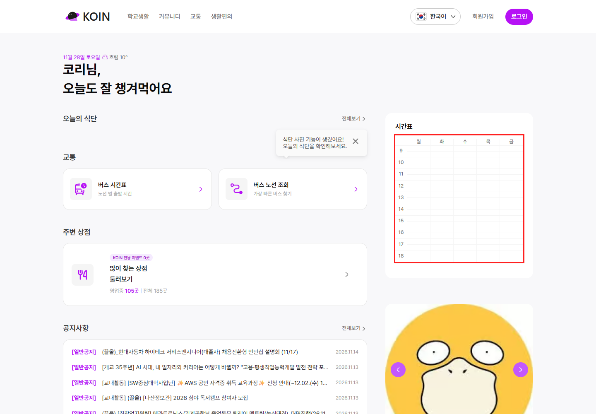

# 1-15 PC 홈 시간표 위젯 본문 클릭

[← 홈화면 리디자인 목록](README.md)

플랫폼: WEB  
원문 상태: 로깅 필요  
[Notion 기준 명세](https://app.notion.com/p/4250221954bc818ba87dff2bbcf8d6a2)  
원본 ID: `4250221954bc818ba87dff2bbcf8d6a2`

<!-- notion-body:start -->
## 이전 로깅

- event\_name: <code>USER</code>
- event\_label: <code>main_timetable</code>
- value: <code>table</code>
- event\_category: <code>click</code>
- 호출 위치: IndexTimetable/index.tsx 75–79행. 기존 수집분은 소급 변경하지 않는다.

## 새 로깅 (26.11.28)

- 설명: PC 홈 오른쪽 시간표 위젯의 격자·과목 본문 링크를 직접 클릭해 시간표 페이지로 이동을 시도할 때 1회 기록한다.
- screen\_view: <code>main</code>
- event\_name: <code>DA1</code>
- event\_label: <code>timetable__main__timetable_entry__widget_entry__click</code>
- value: <code>시간표 위젯</code>
- event\_category: <code>click</code>

- 사진 · WEB (PC)


Stage 실제 화면 · 빨간 네모가 이 계약의 클릭 대상
<!-- notion-body:end -->

<details>
<summary>Notion 원문 속성 전체</summary>

```json
{
  "platform": [
    "WEB"
  ],
  "url": "https://app.notion.com/p/4250221954bc818ba87dff2bbcf8d6a2",
  "구분": "홈화면",
  "상태": "로깅 필요",
  "생성일": "2026-11-27T15:18:40.431Z",
  "이벤트 이름": "1-15 PC 홈 시간표 위젯 본문 클릭"
}
```

</details>
