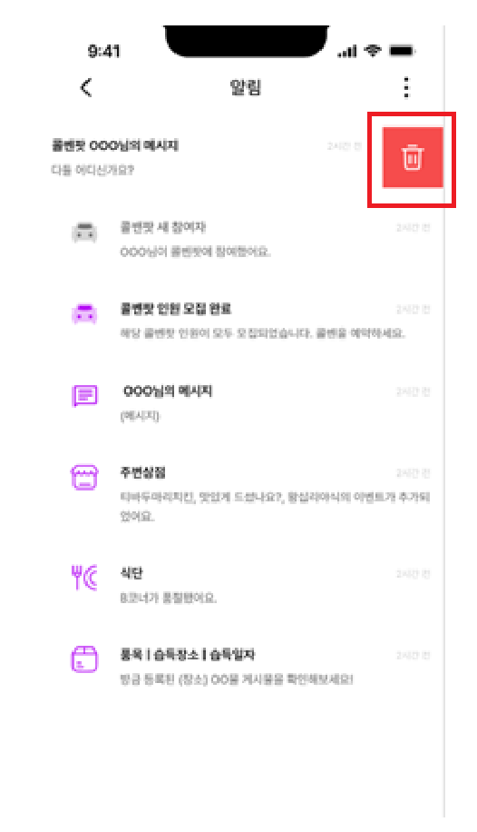

# 1-2-1 알림 클릭 내부

[← 홈화면 리디자인 목록](README.md)

플랫폼: ANDROID, IOS  
원문 상태: 완료  
[Notion 기준 명세](https://app.notion.com/p/3c60221954bc8340b26181442675cd08)  
원본 ID: `3c60221954bc8340b26181442675cd08`

<!-- notion-body:start -->
## 과거 로깅

- event\_label : notification\_list\_delete
- value : 알림 삭제
- event\_category : click



## 새 로깅

<b>알림 삭제</b>

- 설명: 공용 알림 항목을 왼쪽으로 스와이프해 노출한 삭제 버튼을 누를 때 기록한다.
- screen\_view: <code>notification_list</code>
- event\_name: <code>DA2</code>
- event\_label: <code>main__notification_list__notification_list__delete__click</code> /  <code>main__notification_list__notification_list__delete__swipe</code>
- value: 알림 삭제
- event\_category: <code>click</code> / <code>swipe</code>
<!-- notion-body:end -->

<details>
<summary>Notion 원문 속성 전체</summary>

```json
{
  "platform": [
    "ANDROID",
    "IOS"
  ],
  "url": "https://app.notion.com/p/3c60221954bc8340b26181442675cd08",
  "구분": "홈화면",
  "상태": "완료",
  "생성일": "2026-11-23T13:38:47.502Z",
  "이벤트 이름": "1-2-1 알림 클릭 내부"
}
```

</details>
