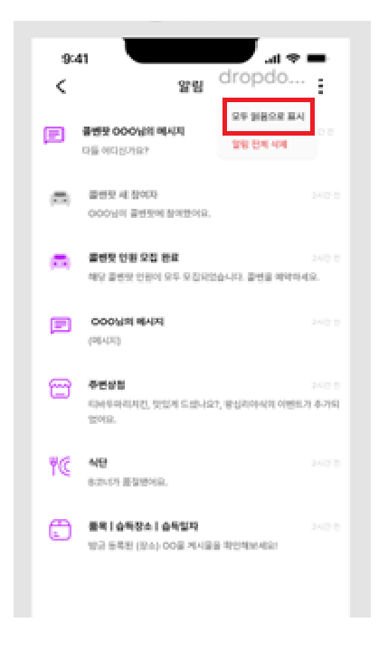
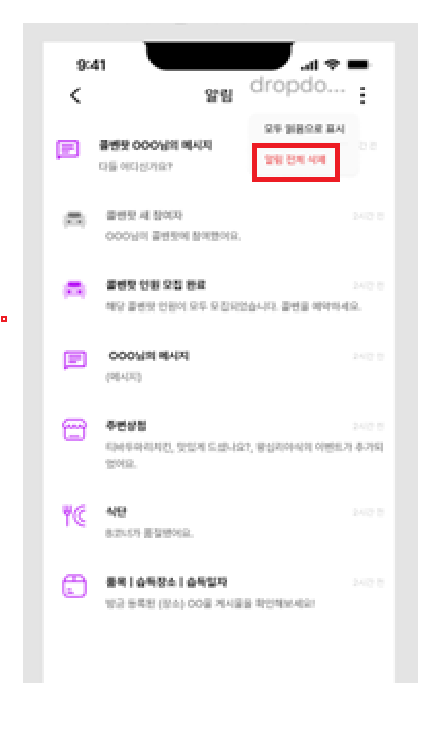

# 1-2-2 알림 클릭 내부

[← 홈화면 리디자인 로깅 목록](README.md)

플랫폼: ANDROID · IOS  
원문 상태: 완료

과거 로깅·새 로깅과 각 참고사진은 원문의 구간별 연결을 유지합니다.

<!-- logging-section:past:start -->
## 과거 로깅

- event\_label : notification\_list\_read\_all
- value : 모두 읽음으로 표시
- event\_category : click

- event\_label : notification\_delete\_all
- value : 알림 전체 삭제
- event\_category : click

<!-- logging-section:past:end -->

<!-- logging-section:new:start -->
## 새 로깅

<b>모두 읽음으로 표시</b>

- 설명: 공용 알림 목록의 모두 읽음으로 표시 버튼을 클릭할 때 기록한다. 처리 성공 시점으로 바꾸지 않는다.
- screen\_view: <code>notification_list</code>
- event\_name: <code>DA2</code>
- event\_label: <code>main__notification_list__notification_list__read_all__click</code>
- value: 모두 읽음으로 표시
- event\_category: <code>click</code>

<b>알림 전체 삭제</b>

- 설명: 공용 알림 목록의 알림 전체 삭제 버튼을 클릭할 때 기록한다. 삭제 결과·확인 창의 추가 이벤트를 만들지 않는다.
- screen\_view: <code>notification_list</code>
- event\_name: <code>DA2</code>
- event\_label: <code>main__notification_list__notification_list__delete_all__click</code>
- value: 알림 전체 삭제
- event\_category: <code>click</code>

<!-- logging-section:new:end -->

---

원문 정보

원본 ID: `a820221954bc83a68616012df15d8576`  
[보존 원문](../../_archive/original/notion/pages/a820221954bc83a68616012df15d8576.md)

