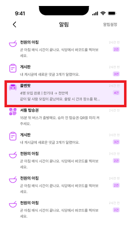

# 1-2 알림 클릭 내부

[← 홈화면 리디자인 로깅 목록](README.md)

플랫폼: ANDROID · IOS  
원문 상태: 완료

과거 로깅·새 로깅과 각 참고사진은 원문의 구간별 연결을 유지합니다.

<!-- logging-section:past:start -->
## 과거 로깅

- event\_label : notification\_list
- value : \{콜벤팟\} or \{천원의 아침\} or \{게시판\}
- event\_category : click

<!-- logging-section:past:end -->

<!-- logging-section:new:start -->
## 새 로깅

<b>콜벤팟 / 천원의 아침 / 게시판</b>

- 설명: 공용 알림 목록에서 개별 알림을 눌러 연결 화면으로 이동할 때 기록한다. value는 선택한 알림의 기존 분류값이며 알림 본문·제목을 수집하지 않는다.
- screen\_view: <code>notification_list</code>
- event\_name: <code>DA2</code>
- event\_label: <code>main__notification_list__notification_list__item_entry__click</code>
- value: 콜벤팟 / 천원의 아침 / 게시판 등등
- event\_category: <code>click</code>

<!-- logging-section:new:end -->

---

원문 정보

원본 ID: `7990221954bc83febb7f816e42f45480`  
[보존 원문](../../_archive/original/notion/pages/7990221954bc83febb7f816e42f45480.md)

