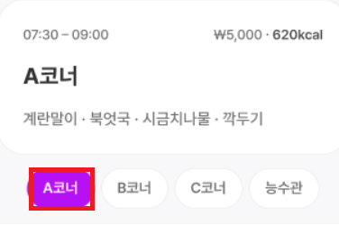
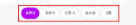
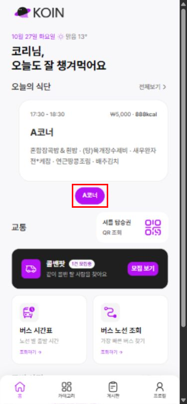

# 1-4 식단 코너 클릭

[← 홈화면 리디자인 목록](README.md)

플랫폼: ANDROID, IOS, WEB  
원문 상태: 완료  
[Notion 기준 명세](https://app.notion.com/p/bc00221954bc83aba6ff816a73420376)  
원본 ID: `bc00221954bc83aba6ff816a73420376`

<!-- notion-body:start -->
## 과거 로깅

- event\_label : menu\_corner
- value : A코너 / B코너 / C코너 / 능수관
- event\_category :  click



## 새 로깅

- 설명: 메인 화면 식단 위젯에서 코너 버튼(A코너 / B코너 / C코너 / 능수관 / 2캠퍼스)을 눌러 보이는 코너를 바꾸는 경우 (식단 화면으로 이동하지 않음). 1-3\~1-7 코너별 페이지를 이 라벨 하나로 합침
- screen\_view: <code>main</code>
- event\_name: <code>DA2</code>
- event\_label: <code>main__main__corner__select</code>
- value: \{코너\} → A코너 / B코너 / C코너 / 능수관 / 2캠퍼스 (예: B코너)
- event\_category: <code>select</code>

### 참고사진 (메인 식단 코너 선택)

<b>웹</b>

<b>참고사진 · 웹</b>



<b>모바일</b>

<b>참고사진 · 모바일</b>


WEB (모바일) · 빨간 네모: 코너 선택 버튼 클릭. stage 실제 화면 캡처에 위치 표시.
<!-- notion-body:end -->

<details>
<summary>Notion 원문 속성 전체</summary>

```json
{
  "platform": [
    "ANDROID",
    "IOS",
    "WEB"
  ],
  "url": "https://app.notion.com/p/bc00221954bc83aba6ff816a73420376",
  "구분": "홈화면",
  "상태": "완료",
  "생성일": "2026-11-23T13:38:48.786Z",
  "이벤트 이름": "1-4 식단 코너 클릭"
}
```

</details>
