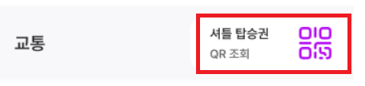
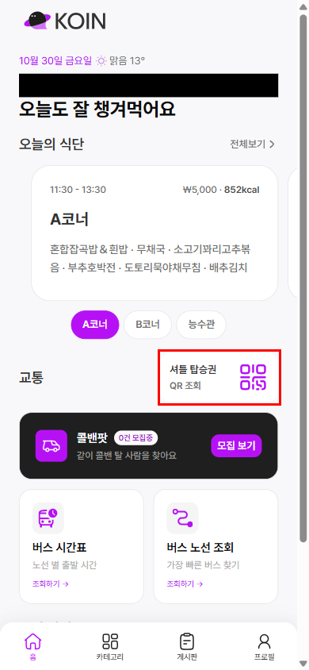

# 1-5 서틀 탑승권 클릭

[← 홈화면 리디자인 로깅 목록](README.md)

플랫폼: ANDROID · IOS · WEB (모바일)  
원문 상태: 완료

과거 로깅·새 로깅과 각 참고사진은 원문의 구간별 연결을 유지합니다.

<!-- logging-section:past:start -->
## 과거 로깅

- event\_label : shuttle\_ticket
- value : 셔틀 탑승권
- event\_category : click

<!-- logging-section:past:end -->

<!-- logging-section:new:start -->
## 새 로깅

- 설명: 메인 화면에서 셔틀 탑승권 버튼을 클릭하는 경우
- screen\_view: <code>main</code>
- event\_name: <code>DA1</code>
- event\_label: <code>ticket__main__bus_entry__ticket_entry__click</code>
- value: 셔틀 탑승권
- event\_category: <code>click</code>

### 참고사진 (기능 표시)

<b>웹</b>

<b>참고사진 · 웹</b>

<b>리디자인 시안에서 미확인 — WEB 클릭 사진 없음</b>

리디자인 시안에서 셔틀 탑승권 버튼은 확인되지 않는다. 해당 위치는 미확인으로 남기며 구디자인의 유니버스 카드 사진을 새 디자인의 클릭 위치로 사용하지 않는다. 모바일 명세와 기존 전송 계약은 유지한다.

[Figma 홈 리디자인](https://www.figma.com/design/DPlcYuiFxhyT5ULbqec59i/KOIN-Web?node-id=11541-33352)

<b>모바일</b>

<b>참고사진 · 모바일</b>

모바일 웹 · 운영 보라색 홈 실제 캡처. 빨간 테두리=셔틀 탑승권 진입. 이름은 검은색 마스킹. Android/iOS 앱 캡처와 구분. 2026-10-30.

<!-- logging-section:new:end -->

---

원문 정보

원본 ID: `5870221954bc8399999b81660b28ea83`  
[보존 원문](../../_archive/original/notion/pages/5870221954bc8399999b81660b28ea83.md)

