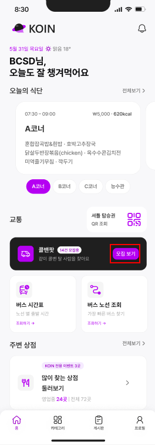

# 1-6 콜벤팟 모집 보기 클릭

[← 홈화면 리디자인 로깅 목록](README.md)

플랫폼: ANDROID · IOS  
원문 상태: 완료

과거 로깅·새 로깅과 각 참고사진은 원문의 구간별 연결을 유지합니다.

<!-- logging-section:past:start -->
## 과거 로깅

- event\_label : callvanpot
- value : 콜밴팟 모집보기
- event\_category : click

<!-- logging-section:past:end -->

<!-- logging-section:new:start -->
## 새 로깅

- 설명: 메인 교통 영역에서 콜밴팟 모집 보기를 클릭한다.
- screen\_view: <code>main</code>
- event\_label: <code>callvan__main__callvan_entry__recruitment_list_entry__click</code>
- event\_name: <code>DA2</code>
- value: 콜밴팟 모집보기
- event\_category: <code>click</code>

### 참고사진 (기능 표시)

<b>모바일 (ANDROID, IOS) / 캡처 출처는 아래 참조</b>

<b>참고사진 · 모바일</b>

화면 정의에 제공된 메인 캡처. 실제 Android 캡처 출처 미확인; 버튼 위치 참고.

<!-- logging-section:new:end -->

---

원문 정보

원본 ID: `59d0221954bc82cdbbbe81dc5b0cb4ee`  
[보존 원문](../../_archive/original/notion/pages/59d0221954bc82cdbbbe81dc5b0cb4ee.md)

