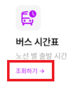
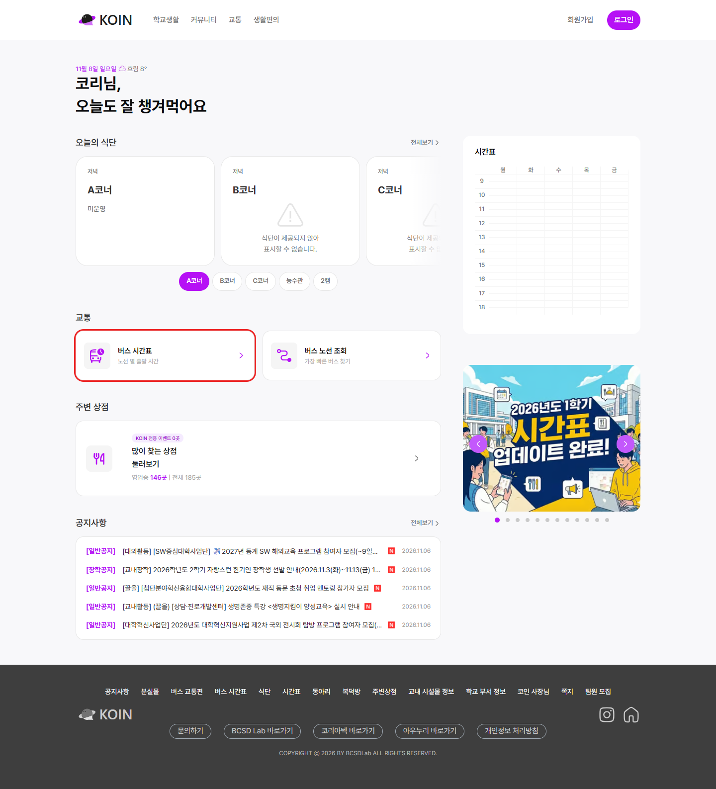
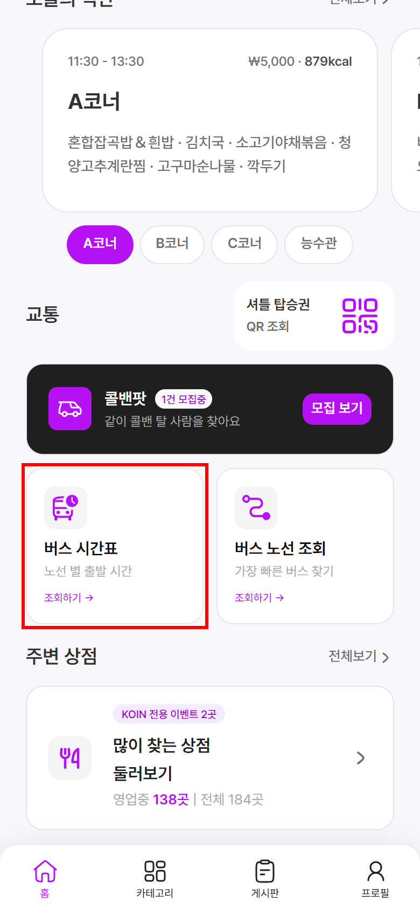

# 1-7 버스 시간표 클릭

[← 홈화면 리디자인 로깅 목록](README.md)

플랫폼: ANDROID · IOS · WEB  
원문 상태: 완료

과거 로깅·새 로깅과 각 참고사진은 원문의 구간별 연결을 유지합니다.

<!-- logging-section:past:start -->
## 과거 로깅

- event\_label : bus\_timetable
- value : 버스 시간표 조회하기
- event\_category : click

<!-- logging-section:past:end -->

<!-- logging-section:new:start -->
## 새 로깅

- 설명: 메인 화면 교통 영역에서 버스 시간표 카드를 클릭해 버스 시간표 화면으로 들어가는 경우
- screen\_view: <code>main</code>
- event\_name: <code>DA2</code>
- event\_label: <code>main__main__bus_entry__timetable_entry__click</code>
- value: 버스 시간표
- event\_category: <code>click</code>

### 참고사진 (기능 표시)

<b>웹</b>

<b>참고사진 · 웹 (Stage 실제 화면)</b>

2026-11-08 [Stage 실제 서비스](https://stage.koreatech.in/) · PC 1440px 브라우저에서 직접 촬영했다. 빨간 테두리는 해당 명세의 버튼 위치다. 현재 WEB 위치 확인에는 이 실제 화면을 우선한다. 모바일 사진·기존 로깅 필드·DB 플랫폼 속성은 유지한다. 화면 확인은 SDK 전송·GA4 수집 검수 완료를 뜻하지 않는다.

<b>모바일</b>

<b>참고사진 · 모바일</b>

모바일 — 버스 시간표 카드 (출처: stage 실제 캡처, 빨간 네모 = 클릭 위치)

<!-- logging-section:new:end -->

---

원문 정보

원본 ID: `a990221954bc827cb049812194ccf592`  
[보존 원문](../../_archive/original/notion/pages/a990221954bc827cb049812194ccf592.md)

