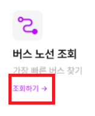
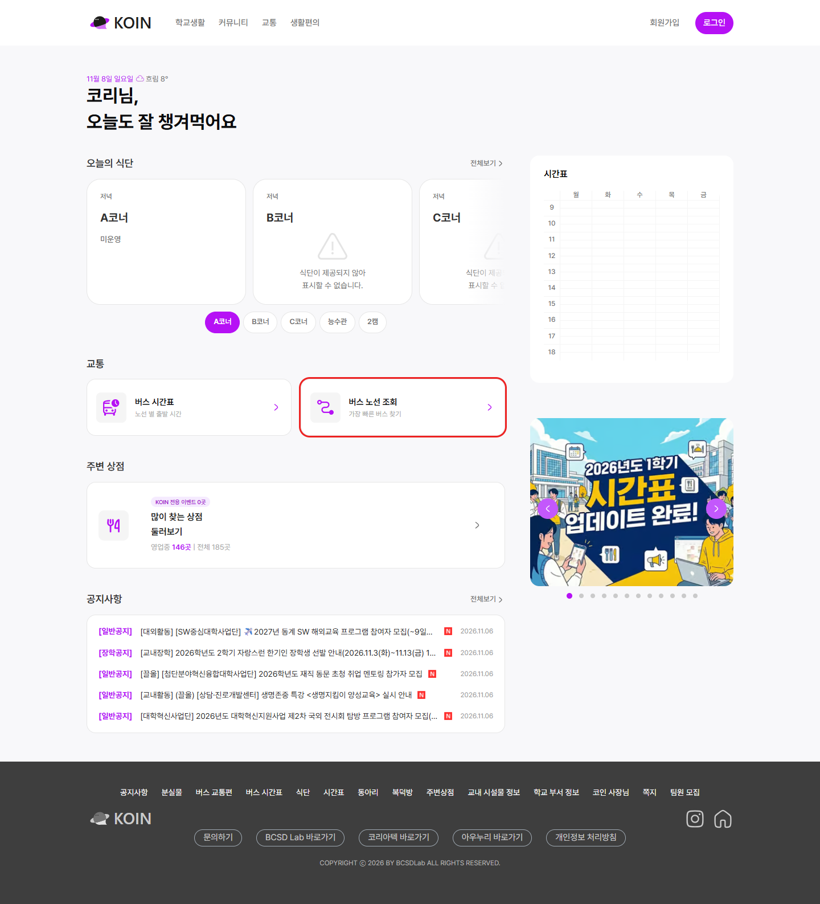
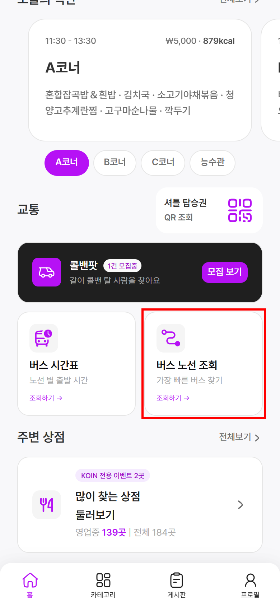

# 1-8 버스 노선 클릭

[← 홈화면 리디자인 목록](README.md)

플랫폼: ANDROID, IOS, WEB  
원문 상태: 완료  
[Notion 기준 명세](https://app.notion.com/p/93c0221954bc82a5b20701ce5f75c697)  
원본 ID: `93c0221954bc82a5b20701ce5f75c697`

<!-- notion-body:start -->
## 과거 로깅

- event\_label : bus\_route
- value : 버스 노선 조회하기
- event\_category : click



## 새 로깅

- 설명: 메인 화면 교통 영역에서 버스 노선 조회 카드를 클릭해 버스 교통편 화면으로 들어가는 경우
- screen\_view: <code>main</code>
- event\_name: <code>DA1</code>
- event\_label: <code>bus__main__bus_entry__search_entry__click</code>
- value: 버스 노선 조회
- event\_category: <code>click</code>

### 참고사진 (기능 표시)

<b>웹</b>

<b>참고사진 · 웹 (Stage 실제 화면)</b>

2026-11-08 [Stage 실제 서비스](https://stage.koreatech.in/) · PC 1440px 브라우저에서 직접 촬영했다. 빨간 테두리는 해당 명세의 버튼 위치다. 현재 WEB 위치 확인에는 이 실제 화면을 우선한다. 모바일 사진·기존 로깅 필드·DB 플랫폼 속성은 유지한다. 화면 확인은 SDK 전송·GA4 수집 검수 완료를 뜻하지 않는다.



<b>모바일</b>

<b>참고사진 · 모바일</b>

모바일 — 버스 노선 조회 카드 (출처: stage 실제 캡처, 빨간 네모 = 클릭 위치)


<!-- notion-body:end -->

<details>
<summary>Notion 원문 속성 전체</summary>

```json
{
  "platform": [
    "ANDROID",
    "IOS",
    "WEB"
  ],
  "url": "https://app.notion.com/p/93c0221954bc82a5b20701ce5f75c697",
  "구분": "홈화면",
  "상태": "완료",
  "생성일": "2026-11-23T13:38:48.394Z",
  "이벤트 이름": "1-8 버스 노선 클릭"
}
```

</details>
