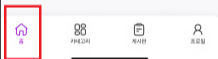

# 2-1 네비게이션 바 홈 클릭 

[← 홈화면 리디자인 목록](README.md)

플랫폼: ANDROID, IOS, WEB (모바일)  
원문 상태: 완료  
[Notion 기준 명세](https://app.notion.com/p/fff0221954bc836ca4ba8132a790122d)  
원본 ID: `fff0221954bc836ca4ba8132a790122d`

<!-- notion-body:start -->
## 과거 로깅

- event\_label : nav\_home
- value : 홈
- event\_category : click



## 새 로깅

<b>홈</b>

- 설명: 공용 하단 네비게이션 바에서 홈 항목을 클릭할 때 기록한다.
- screen\_view: <code>main</code>
- event\_name: <code>DA2</code>
- event\_label: <code>main__main__navigation__main_entry__click</code>
- value: 홈
- event\_category: <code>click</code>
<!-- notion-body:end -->

<details>
<summary>Notion 원문 속성 전체</summary>

```json
{
  "platform": [
    "ANDROID",
    "IOS",
    "WEB (모바일)"
  ],
  "url": "https://app.notion.com/p/fff0221954bc836ca4ba8132a790122d",
  "구분": "네비게이션 바",
  "상태": "완료",
  "생성일": "2026-11-23T13:38:48.947Z",
  "이벤트 이름": "2-1 네비게이션 바 홈 클릭 "
}
```

</details>
